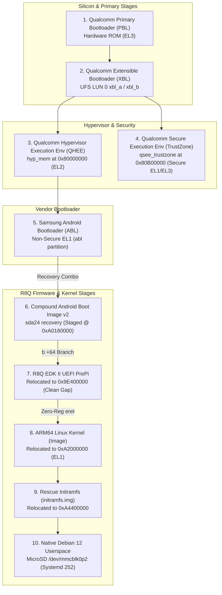

# Project R8Q — Boot Architecture & Execution Lifecycle

**Target Device:** Samsung Galaxy S20 FE 5G (`SM-G781B` / `r8q`)  
**SoC:** Qualcomm Snapdragon 865 (`SM8250` / Kona)  
**Document Classification:** Architecture Specification  
**Baseline Commit:** `4312b18eca26f7b44a99fd74e5c703109688d97d`  

---

## 1. Architectural Overview & Bootchain Sequence

Project R8Q implements an integrated bare-metal bootchain that transitions from Qualcomm hardcoded silicon ROM down to Debian GNU/Linux userspace running Systemd:



---

## 2. Stage-by-Stage Boot Execution Analysis

### 2.1 Qualcomm PBL (Primary Bootloader)
- **Location:** Silicon ROM inside the Snapdragon 865 SoC.
- **Privilege Level:** Secure EL3.
- **Responsibilities:**
  - Performs initial power-on reset (POR) and configures basic internal clocks.
  - Queries hardware boot strap pins and registers.
  - Validates and loads Qualcomm XBL from the primary boot partition (`xbl_a` / `xbl_b`) on UFS storage.
  - Provides emergency fallback to Qualcomm EDL Mode (`Qualcomm HS-USB QDLoader 9008`) if UFS signature checks fail or key combinations are triggered.

### 2.2 Qualcomm XBL (Extensible Boot Loader)
- **Location:** UFS storage partition `xbl` / `xbl_config`.
- **Privilege Level:** Secure EL1 / EL3.
- **Responsibilities:**
  - Initializes LPDDR5 SDRAM controller, setting up full 6 GiB / 8 GiB physical memory.
  - Initializes Qualcomm Always-On Processor (`xbl_aop_mem` at `0x80603000`).
  - Carves out shared memory (`smem_mem` at `0x80900000`) and command database (`cmd_db` at `0x80860000`).
  - Loads Qualcomm QSEE (TrustZone) into `0x80B00000`–`0x88400000` and Qualcomm Hypervisor (QHEE) into `0x80000000`–`0x80600000`.
  - Handoffs execution to QHEE at EL2.

### 2.3 Samsung ABL (Android Bootloader)
- **Location:** UFS partition `abl_a` / `abl_b`.
- **Privilege Level:** Non-Secure EL1 (executed under QHEE hypervisor).
- **Responsibilities:**
  - Evaluates hardware keypresses during power-on:
    - *Default (No keys held):* Loads production Android / LineageOS kernel from `sda23` (`boot`).
    - *Recovery Combo (`Power + Volume Up` with USB-C connected):* Loads custom recovery container from `sda24` (`recovery`).
  - Validates Android Boot Image Header Version 2 structure.
  - Bypasses cryptographic verification because physical Knox eFuse is permanently tripped to `0x1` (`WARRANTY VOID: 1`).
  - Stages the entire compound boot image into physical DRAM at base `0xA0160000`.
  - Prepares Device Tree Blob (DTB) and passes DTB pointer in CPU register `x0`.
  - Branches directly to offset `+0x1000` (`0xA0161000`).

### 2.4 Custom R8Q EDK II UEFI Firmware
- **Binary:** `R8Q_EFI.fd` (4,194,304 bytes).
- **Entry Wrapper:**
  - Offset `0x1000` contains the 64-byte ARM64 wrapper with instruction `0x14000010` (`b +64`), which skips over the header and branches directly into `R8Q_EFI.fd` at `0x1040`.
- **PrePi Initialization (`ModuleEntryPoint.S`):**
  1. Captures DTB pointer from register `x0` into callee-saved register `x19`.
  2. Masks all DAIF interrupts (`msr daifset, #0xf`).
  3. Enables SIMD/floating point access (`msr cpacr_el1, x1`).
  4. Sets up initial descending stack at `sp = 0x9E890000`.
  5. Relocates the entire 4 MiB firmware volume to the clean, unreserved DRAM base at **`0x9E400000`**.
- **C Runtime Dispatch (`PrePi.c`):**
  1. Initializes continuous splash AMOLED framebuffer (`0x9C000000`), drawing the Royal Blue diagnostic banner.
  2. Discovers the staged compound container in high DRAM (probing candidate offsets `0xA0561040` vs `0xA0560040`).
  3. Parses the ARM64 Linux kernel header, calculating exact initialized copy length (`16,802,304` bytes) and zeroing BSS (`433,664` bytes) to prevent ramdisk over-read corruption.
  4. Relocates the Linux kernel to **`0xA2000000`** (strictly 2 MiB-aligned).
  5. Relocates `sm8250-samsung-r8q.dtb` to **`0xA4000000`** and patches the `/chosen` node with earlycon parameters and initramfs physical memory boundaries.
  6. Relocates `initramfs.img` to **`0xA4400000`**.
  7. Cleans and invalidates caches to Point of Coherence (`dc civac`) across all relocated regions.
  8. Invalidates translation lookaside buffers (`tlbi vmalle1`).
  9. Draws solid bright green screen (`0x0000FF00`) on AMOLED.
  10. Clears registers `x1..x3 = 0`, sets `x0 = 0xA4000000` (DTB pointer), and executes zero-register `eret` to jump into the Linux kernel entry point at EL1.

### 2.5 Linux Kernel (`Image`)
- **Binary:** ARM64 Linux Kernel with EFI Stub support (`Image`, 17,197,568 bytes).
- **Execution Level:** Non-Secure EL1.
- **Boot Protocol Compliance:**
  - Conforms to ARM64 Boot Protocol (`Documentation/arm64/booting.rst`).
  - MMU disabled, caches cleaned to PoC, interrupts masked.
  - Register contract: `x0` = 64-bit physical address of DTB; `x1..x3` = 0.
- **Execution Flow:**
  - `head.S` initializes kernel page tables, switches to virtual addressing, and mounts early fixmaps.
  - `msm_geni_serial` earlycon activates at `0xa90000`, streaming kernel log messages.
  - SimpleDRM driver attaches to framebuffer at `0x9C000000`, replacing green screen with Tux bootsplash and terminal console (`tty0`).
  - Discovers secondary Kryo 585 CPU cores via PSCI `CPU_ON` SMC calls.
  - Mounts initramfs from DRAM buffer `0xA4400000` and executes `/init`.

### 2.6 Rescue Initramfs (`initramfs.img`)
- **Archive:** Gzip-compressed CPIO (`newc`) archive (2,947,562 bytes).
- **Userspace Runtime:** Pure ARM64 `/bin/busybox`.
- **Execution Flow:**
  - Mounts virtual filesystems: `devtmpfs` on `/dev`, `procfs` on `/proc`, `sysfs` on `/sys`.
  - Enforces mandatory read-only policy on internal UFS partitions.
  - Enumerates external storage:
    - *Path A:* Directly mounts `/dev/mmcblk0p2` (ext4 partition labeled `r8q-rootfs`) to `/newroot`.
    - *Path B:* Discovers `/r8q-rootfs.ext4` on `/dev/mmcblk0p1` (FAT32/exFAT), attaches `/dev/loop0`, and mounts to `/newroot`.
    - *Path C (Emergency Fallback):* If storage cannot be located, configures USB CDC-Ethernet gadget network (`172.16.42.1`) and spawns interactive rescue shell.
  - Executes `exec switch_root /newroot /usr/lib/systemd/systemd`.

### 2.7 Native Debian 12 Userspace
- **Root Filesystem:** Standalone ext4 disk image `r8q-rootfs.ext4` (2,147,483,648 bytes / 2.00 GiB).
- **Init System:** Systemd 252 (Debian Bookworm ARM64).
- **Execution Targets:**
  - `sysinit.target` -> `basic.target` -> `multi-user.target`.
  - Spawns `systemd-udevd` to coldplug SM8250 platform devices.
  - Launches `getty@tty1.service` on AMOLED display (1080x2400 console).
  - Launches `serial-getty@ttyMSM0.service` on Qualcomm GENI UART serial.
  - Initializes `systemd-networkd` and starts OpenSSH daemon on port 22.

---

## 3. Physical DRAM Memory Map Architecture

All 39 physical memory regions defined in `docs/phase3_6/r8q_physical_memory_map.json` maintain strictly non-overlapping boundaries:

```
Physical DRAM Memory Allocation (SM8250 / 6+ GB):
0x80000000 ┌────────────────────────────────────────────────────────┐
           │ Qualcomm Hypervisor (QHEE) Carveout [hyp_mem, 6 MiB]   │
0x80603000 ├────────────────────────────────────────────────────────┤
           │ Always-On Processor (AOP) [xbl_aop_mem, 2.36 MiB]      │
0x80B00000 ├────────────────────────────────────────────────────────┤
           │ Qualcomm TrustZone Secure Environment [qsee, 121 MiB]  │
0x88400000 ├────────────────────────────────────────────────────────┤
           │ PIL Subsystem Carveouts (ADSP, CDSP, Modem, GPU)       │
0x9C000000 ├────────────────────────────────────────────────────────┤
           │ AMOLED Continuous Splash Framebuffer [35 MiB]          │
0x9E300000 ├────────────────────────────────────────────────────────┤
           │ Dynamic Frame Rate Carveout [dfps_data, 1 MiB]         │
0x9E400000 ├────────────────────────────────────────────────────────┤
           │ ★ AUTHORITATIVE R8Q UEFI FIRMWARE BASE [4 MiB]          │
0x9E800000 ├────────────────────────────────────────────────────────┤
           │ UEFI Heap & Working BSS [512 KiB]                      │
0x9E880000 ├────────────────────────────────────────────────────────┤
           │ Early PrePi Stack (Top: 0x9E890000, Limit: 0x9E880000) │
0x9E890000 ├────────────────────────────────────────────────────────┤
           │ Clean Unreserved Free Gap [7,616 KiB / 7.44 MiB]       │
0x9F000000 ├────────────────────────────────────────────────────────┤
           │ Protected OEM Carveout: Samsung sec_debug [8 MiB]      │
0x9F800000 ├────────────────────────────────────────────────────────┤
           │ Protected OEM Carveout: Samsung ss_plog [2 MiB]        │
0x9FA00000 ├────────────────────────────────────────────────────────┤
           │ Protected OEM Carveout: Samsung ramoops [1 MiB]        │
0xA0160000 ├────────────────────────────────────────────────────────┤
           │ Staged Compound Boot Image Container [22.95 MiB]       │
0xA2000000 ├────────────────────────────────────────────────────────┤
           │ ★ RELOCATED LINUX KERNEL EXECUTION WINDOW [16.8 MiB]   │
0xA4000000 ├────────────────────────────────────────────────────────┤
           │ Relocated Patched Device Tree Blob [2 MiB buffer]      │
0xA4400000 ├────────────────────────────────────────────────────────┤
           │ Relocated Rescue Initramfs Buffer [32 MiB buffer]      │
0xA6400000 ├────────────────────────────────────────────────────────┤
           │ High System DRAM: Debian Userspace Memory Pool (4+ GB) │
           └────────────────────────────────────────────────────────┘
```

The 528 pairwise combinations $\binom{33}{2}$ between the 27 hardware carveouts and 6 independent live allocations have been proven strictly non-overlapping.

---

*Authored by Project R8Q Engineering.*
