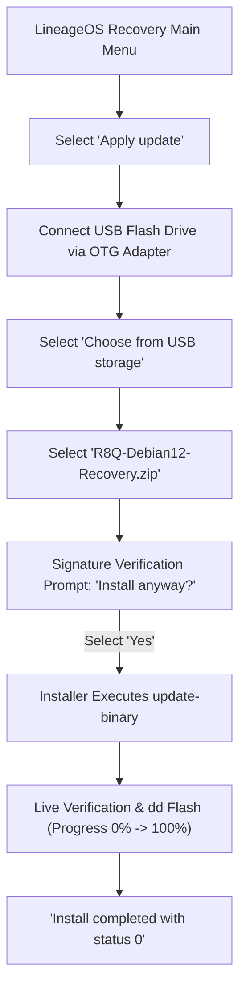

# Project R8Q — LineageOS Recovery USB OTG Installation Guide

**Target Platform:** Samsung Galaxy S20 FE 5G (`SM-G781B` / `r8q`)  
**SoC:** Qualcomm Snapdragon 865 (`SM8250` / Kona / Adreno 650)  
**Package:** `R8Q-Debian12-Recovery.zip` (10,234,189 bytes / 9.76 MiB)  
**Target Slot:** `/dev/block/by-name/recovery` (`/dev/block/sda24`)  
**Environment:** Official LineageOS 23.2 Recovery (Android 16 / Linux 4.19 / 6.x)  
**Classification:** USB OTG Staging & Recovery Installation Manual  
**Safety Status:** **PREPARATION ONLY — NO FLASHING AUTHORIZED WITHOUT USER APPROVAL**  

---

> [!CAUTION]
> **SAFETY GATE NOTICE — PRE-EXECUTION AUDIT ONLY**  
> This guide outlines the exact physical procedure for deploying `R8Q-Debian12-Recovery.zip` from a USB flash drive via USB Type-C OTG using the existing LineageOS Recovery environment on the handset.  
> **No flashing commands have been executed.** All block devices, partition tables, and firmware slices remain completely unmodified. Do not initiate flashing without reviewing the verification report and verifying offline backups.

---

## 1. Hardware & Media Prerequisites

Before performing USB OTG installation, ensure the following equipment is ready:

| Item | Specification | Verification / Prerequisite Role |
| :--- | :--- | :--- |
| **Target Handset** | Samsung Galaxy S20 FE 5G (`SM-G781B` / `r8q`). | Unlocked bootloader (`OEM unlocking: ON`, Knox `0x1`). |
| **Current Recovery** | LineageOS 23 Recovery running on `sda24`. | Validated from empirical ramdisk dump. |
| **USB Flash Drive** | USB 2.0/3.0/3.1 flash drive ($\ge 1\text{ GB}$). | Formatted as **FAT32** or **exFAT** with MBR or GPT. |
| **USB-C OTG Adapter** | Type-C Male to Type-A Female adapter (or native dual Type-C USB drive). | Provides physical connection to handset Type-C port. |
| **Battery Level** | $\ge 70\%$ charge capacity. | Prevents power brownout during recovery execution. |
| **External MicroSD** | MicroSD card prepared with Debian rootfs (`r8q-rootfs.ext4` on partition 1 or 2). | Required for Debian userspace pivot after kernel handoff. |

---

## 2. Preparing the USB Flash Drive

1. Connect the USB flash drive to your workstation.
2. Format the USB flash drive with a single FAT32 or exFAT partition (if not already formatted):
   ```bash
   # On Linux workstation (ensure /dev/sdX is your USB drive!):
   sudo mkfs.vfat -F 32 -n "R8Q_USB" /dev/sdX1
   ```
3. Copy the recovery installer package to the root of the USB drive:
   ```bash
   cp R8Q-Debian12-Recovery.zip /media/user/R8Q_USB/
   sync
   ```
4. Verify the file checksum directly on the USB drive:
   ```bash
   sha256sum /media/user/R8Q_USB/R8Q-Debian12-Recovery.zip
   ```
   **Expected Hash:** `d969430b84cc69f40cdf3325add813dcbdf0c9704f0e9e226af6b59ad3ec1fe6`
5. Safely unmount and eject the USB drive.

---

## 3. Booting into LineageOS Recovery

There are two primary methods to enter the existing LineageOS Recovery environment:

### Method A: Hardware Button Combination (Cold Boot)
1. Power off the Samsung Galaxy S20 FE 5G completely.
2. **Crucial Samsung Hardware Interlock:** Connect a USB-C cable attached to a powered PC or charger (Samsung One UI / modern bootloader requires an active USB host connection to acknowledge the recovery key combination).
3. Press and hold `Power + Volume Up` simultaneously.
4. When the `Samsung Galaxy` splash screen appears, keep holding `Volume Up` until the screen transitions to the LineageOS Recovery interface.
5. Release all buttons. Disconnect the USB charging cable.

### Method B: Software Reboot via ADB (From Active Android)
If booted into the production LineageOS 23 Android system:
```bash
adb reboot recovery
```

---

## 4. Navigating LineageOS Recovery & Flashing via USB OTG

Once the LineageOS Recovery graphical interface appears on the AMOLED screen:



### Step-by-Step Recovery Navigation:
1. Connect the prepared USB flash drive to the phone's USB Type-C port using the OTG adapter.
2. On the touch screen (or using `Volume Up/Down` to navigate and `Power` to select):
   - Touch **Apply update** (or navigate and select with `Power`).
3. Select **Choose from USB storage** (or **Apply from USB storage**).
   - LineageOS Recovery automatically mounts the USB device via vold (`/devices/platform/soc/*.ssusb/*.dwc3/xhci-hcd.*.auto*`).
4. Browse to and select:
   **`R8Q-Debian12-Recovery.zip`**
5. **Handling the Recovery Signature Verification Prompt:**
   - LineageOS Recovery checks for official LineageOS cryptographic signatures. Because this is a custom bare-metal UEFI installer, LineageOS Recovery will display:
     ```
     Signature verification failed. Install anyway?
     [ Yes ]    [ No ]
     ```
   - Tap **Yes** (or navigate to `Yes` and press `Power`).
   - LineageOS Recovery invokes `/tmp/update-binary 3 <pipe_fd> /mnt/usb/R8Q-Debian12-Recovery.zip`.

---

## 5. Real-Time Installer Execution & Visual Verification Logs

As `update-binary` executes, it streams real-time status messages to the AMOLED display:

```
==================================================
  PROJECT R8Q: NATIVE DEBIAN 12 ARM64 INSTALLER   
  Target: Samsung Galaxy S20 FE 5G (SM-G781B)     
  Environment: LineageOS Recovery (Android)       
==================================================
[STEP 1/6] Verifying target device hardware...
  Detected Device: r8q (SM-G781B)
  Device verification PASSED.
[STEP 2/6] Auditing destination partition metadata...
  Target block node: /dev/block/bootdevice/by-name/recovery -> /dev/block/sda24
  Confirmed destination node: sda24 (recovery slot).
  Partition Capacity: 82694144 bytes (expected: 82694144 bytes)
  Partition geometry verification PASSED.
[STEP 3/6] Extracting boot container to scratch buffer...
  Extracted Payload Size: 24461312 bytes (expected: 24461312 bytes)
[STEP 4/6] Verifying payload SHA-256 integrity...
  Calculated SHA-256: b2d6f721fe52633e4bee4e1a626514fc5cbe166102803d8b6f0a5c581c5cb100
  Cryptographic verification PASSED.
[STEP 5/6] Calculating safety headroom margin...
  Headroom remaining: 58232832 bytes (55 MiB)
  Safety margin verification PASSED (55.53 MiB clearance).
[STEP 6/6] Staging compound boot image to /dev/block/sda24...
  Writing 5972 pages (4096 B/page) via dd...
  Performing readback verification from /dev/block/sda24...
  Readback verification PASSED bit-for-bit.
==================================================
[SUCCESS] Project R8Q UEFI successfully staged!  
  Target: /dev/block/sda24 (recovery)                   
  Bytes written: 24461312                    
  Primary OS (sda23 boot) preserved 100% intact. 
==================================================
Reboot to Recovery (Power + Vol Up with USB) to boot R8Q.
```

The recovery UI will confirm:
`Install completed with status 0.`

---

## 6. First Boot Execution Procedure

Following successful staging:
1. Tap the back arrow in LineageOS Recovery or navigate to **Advanced** -> **Reboot to recovery**.
2. Alternatively: Power off device completely, connect USB-C cable to PC, and hold `Power + Volume Up`.
3. **Expected AMOLED Visual Sequence:**
   - **Stage 1 (PrePi Entry):** Top 120 pixels render a Royal Blue banner (`0x001B365D`) with Cyan DTB, Emerald memory, and Amber discovery badges.
   - **Stage 2 (Kernel Handoff):** Solid Bright Green block (`0x0000FF00`) fills entire screen.
   - **Stage 3 & 4 (Kernel & Console):** Green screen clears; Linux Tux bootsplash renders; `printk` logs stream on framebuffer console (`tty0`).
   - **Stage 5 (Initramfs):** Banner `[PROJECT R8Q: NATIVE LINUX INITRAMFS]` renders; MicroSD card is mounted.
   - **Stage 6 (Debian 12 Userspace):** Virtual terminal login prompt appears on AMOLED screen (`r8q login:`).

---

## 7. Recovery & Rollback Procedure

Because Project R8Q was staged strictly into `/dev/block/sda24` (`recovery`):

### 7.1 Instant Rollback to Daily Production OS (Zero Restoration Needed)
- Simply press `Power` normally (no volume keys held).
- Samsung ABL loads `/dev/block/sda23` (`boot`), booting directly into your active LineageOS 23 + Magisk installation.
- Your daily Android apps, data, and settings are 100% untouched.

### 7.2 Restoring Stock LineageOS Recovery
To restore the original LineageOS Recovery onto `sda24`:
1. Boot into LineageOS 23 Android normally.
2. In Termux (with root) or via ADB root shell:
   ```bash
   adb root
   adb push sda24_lineageos_recovery.img /sdcard/
   adb shell
   # Run audited page-aligned restore command:
   dd if=/sdcard/sda24_lineageos_recovery.img of=/dev/block/bootdevice/by-name/recovery bs=4096 count=20189 conv=fsync
   ```
3. LineageOS Recovery is restored bit-for-bit to its factory state.

---

*Project R8Q — Native Debian 12 ARM64 Engineering Team.*
