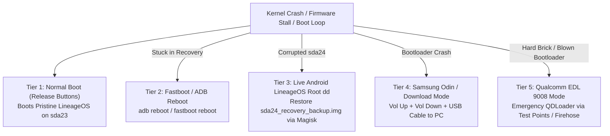

# Project R8Q — Hardware Recovery Plan & Boot Mode Contingency Matrix

**Target Device:** Samsung Galaxy S20 FE 5G (`SM-G781B` / `r8q`)  
**SoC:** Qualcomm Snapdragon 865 (`SM8250` / Kona)  
**Document Classification:** Emergency Recovery & Fault Remediation Plan  
**Baseline Commit:** `4312b18eca26f7b44a99fd74e5c703109688d97d`  

---

## 1. Multi-Tier Recovery Architecture

Project R8Q incorporates a five-tier hardware recovery contingency matrix designed to guarantee device recoverability regardless of software faults encountered during bare-metal Linux development:



---

## 2. Hardware Boot Modes & Trigger Mechanics

| Boot Mode | Hardware Trigger / Keypress Combo | Target Partition / Stage | Purpose & Diagnostic Role |
| :--- | :--- | :--- | :--- |
| **Normal Boot (Tier 1)** | Press `Power` button once from powered-off state (no volume keys held). | `/dev/block/sda23` (`boot`) | Boots the production LineageOS 23 / Android kernel. Completely bypasses recovery slot `sda24`. |
| **Recovery Boot (Tier 2)** | Hold `Power + Volume Up` with USB-C cable connected to host PC or charger. | `/dev/block/sda24` (`recovery`) | Stages the custom R8Q compound boot image (`r8q-uefi-boot-complete.img`). |
| **Samsung Download Mode (Tier 4)** | Power off completely. Hold `Volume Up + Volume Down` simultaneously while inserting USB-C cable connected to PC. | Internal Bootloader (Odin protocol) | Samsung Odin3 / Heimdall low-level firmware flashing interface. |
| **Qualcomm EDL 9008 (Tier 5)** | Hardware test point short-circuit to ground or specialized EDL deep-flash cable during battery connect. | Qualcomm PBL ROM (Emergency) | Qualcomm Sahara / Firehose raw programmer interface. |

---

## 3. Recovery Prerequisites & Safety Checklist

Prior to attempting any physical installation on the target handset in Phase 3.6B, the operator must complete the following mandatory recovery preparations:

1. **Host Workstation Environment:**
   - Linux PC with `adb`, `fastboot`, and `heimdall` (or Windows PC with Samsung USB Drivers and Odin3 v3.14.4).
   - Known-good high-speed USB-C data cable connected directly to a motherboard USB 3.0 root port (avoid passive hubs).
2. **Offline Partition Backups:**
   - Bit-exact copies of `sda23_boot_backup.img` (67,108,864 bytes) and `sda24_recovery_backup.img` (82,694,144 bytes) stored safely on host workstation SSD and verified via SHA-256.
3. **Firmware Stock Package:**
   - Full 4-file / 5-file Samsung stock firmware archive matching baseband version `G781BXXSIHYJ4` extracted and ready for Odin emergency restoration.
4. **Battery Charge Threshold:**
   - Battery state-of-charge verified at $\ge 70\%$. Flashing or rebooting on low battery risks PMIC power cuts during critical bootloader transitions.

---

## 4. Remediation Procedures by Failure Scenario

### Scenario A: R8Q Linux Fails to Boot (Screen Stalls on Black Screen or Royal Blue Banner)
1. **Diagnosis:** Firmware volume relocation succeeded, but kernel handoff stalled or DTB parsing failed.
2. **Immediate Recovery Action (Tier 1):**
   - Press and hold `Power + Volume Down` for 10 seconds to force hardware reset.
   - Release all buttons immediately as soon as the screen turns black.
   - Do not hold `Volume Up`.
   - The device boots normally into LineageOS 23 from `sda23`.

### Scenario B: Boot Loop in Recovery Mode
1. **Diagnosis:** ABL rejects boot image header or kernel panics immediately upon EL1 entry.
2. **Immediate Recovery Action:**
   - Unplug USB cable to break recovery loop triggers.
   - Force restart by holding `Power + Volume Down` for 10 seconds.
   - Allow phone to boot into LineageOS 23.
   - Connect via ADB root:
     ```bash
     adb root
     adb shell
     ```
   - Restore original recovery partition:
     ```bash
     dd if=/sdcard/sda24_recovery_backup.img of=/dev/block/sda24 bs=4096 count=20189 conv=fsync
     ```

### Scenario C: Unresponsive Bootloader / Corrupted Partition Table (Tier 4 Odin)
1. **Diagnosis:** ABL fails to load; device will not reach normal boot or recovery.
2. **Odin Restore Procedure:**
   - Unplug device and power off completely (hold `Power + Volume Down` until screen stays off).
   - Hold both `Volume Up` and `Volume Down` buttons simultaneously.
   - Insert USB cable connected to PC.
   - Screen turns light blue with `Warning: A custom OS can cause critical problems`.
   - Press `Volume Up` once to enter `Download Mode`.
   - On PC, launch Odin3 or run Heimdall:
     ```bash
     heimdall flash --RECOVERY stock_recovery.img
     ```
   - Device restarts into functional factory bootloader.

---

## 5. Strict Limitations: No Unverified Recovery Guarantees

> [!WARNING]
> **NO UNVERIFIED RECOVERY GUARANTEES**  
> While the multi-tier recovery architecture provides industry-standard protection against software-induced boot failures, the engineering team explicitly states:
> 
> 1. **Zero Warranty:** Flashing modified bootloaders or custom kernels carries inherent risks of permanent hardware damage.
> 2. **Irreversible Cryptographic Destruction (`sda25`):** If partition `sda25` (`keyrefuge`) is corrupted by out-of-boundary writes or whole-disk `dd` commands, recovery via Odin or Heimdall **CANNOT restore Knox keystore material**. Knox-dependent features (Samsung Pay, Secure Folder, hardware keystore attestations) will be permanently lost.
> 3. **Hardware eFuse Integrity:** The Knox warranty bit (`0x1`) cannot be reset by any software recovery procedure.
> 4. **Hardware Installation Gate:** Physical staging onto `sda24` remains **PENDING HARDWARE VALIDATION (PHASE 3.6B GATE)**.

*Authored by Project R8Q Engineering.*
