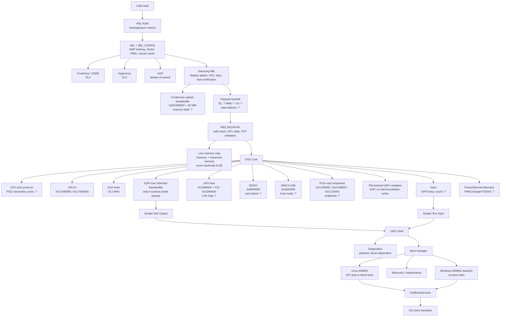

# Project R8Q UEFI: Hardware Initialization Dependency Graph

**Target:** Samsung Galaxy S20 FE 5G (`SM-G781B`, `r8q`, SM8250)
**Document revision:** 1.1.0-M1 (corrected baseline)
**Status:** Research dependency model. Ownership and sequencing are partly inferred.

---

## 1. How to read this document

The graph separates four owners:

- **Stock firmware** — PBL/XBL/AOP/TrustZone/ABL. R8Q UEFI does not replace or reinitialize these.
- **R8Q UEFI** — the payload and its DXE drivers.
- **Operating system** — Linux or Windows drivers after `ExitBootServices()`.
- **Unknown** — behavior that must be measured on the target unit.

A solid arrow means "is known to be required." A dashed arrow means "is inferred or conditional." A node marked `?` has an unresolved hardware or handoff dependency.

---

## 2. Initialization graph

---

## 3. Ownership matrix

| Subsystem | Hardware / interface | Initialized by | R8Q UEFI role | Status |
|---|---|---|---|---|
| CPU cores | 8× Kryo 485, PSCI | XBL/PSCI | Use boot CPU; bring up secondaries only after PSCI validation | `V-L6.18` topology; PSCI `V`; actual state `U` |
| RAM | LPDDR5, two ranges in captured FDT | XBL | Parse live map; reserve carveouts; allocate safely | `V-R8Q-FDT` for captured unit; variants `U` |
| Interrupts | GICv3 `0x17A00000`/`0x17A60000` | XBL/ABL | Initialize non-secure GIC, preserve secure interrupts | Addresses `V`; handoff state `U` |
| Timer | ARM generic timer, 19.2 MHz | XBL | Architectural timer driver | `V-L6.18` |
| Display | MDSS `0xAE00000`, DSI PHY/PLL | ABL | Reuse inherited framebuffer if probe passes; do not reinit DPU/DSI early | Addresses `V`; scanout `U` |
| UFS | `0x1D84000`, ICE `0x1D90000` | XBL/ABL | Host driver, LUN/partition enumeration | Addresses `V`; LUN map `U` |
| MicroSD | SDHCI `0x8804000` | R8Q UEFI | Host driver, card detect, FAT | Addresses `V`; hotplug `U` |
| USB | DWC3 `0xA600000` | R8Q UEFI | Host/XHCI and HID, if hardware supports it | Downstream DRD `V`; host mode `U` |
| PCIe | 3 root complexes | XBL/R8Q UEFI | Enumeration, endpoint discovery | Addresses `V`; endpoints `U` |
| WLAN | QCA6490 node on PCIe RC0; BT node lists QCA6390/QCA6490 | R8Q UEFI/OS | Firmware load and PCIe enumeration | Nodes `V`; module identity/functionality `U` |
| PMIC | PM8150/PM8150B/PM8150L | XBL/AOP | Read-only telemetry, regulators only if documented | Nodes `V`; safe access `U` |
| Charger | MAX77705, PCA9468, SMB5 (disabled) | XBL/ABL | Telemetry; no charging control in early bring-up | Nodes `V`; active path `U` |
| Fuel gauge | Unknown | XBL/ABL | Telemetry only after identification | `U` |
| Thermal | TSENS `0xC222000`/`0xC263000`, `0xC223000`/`0xC265000` | XBL | Read sensors after driver validation | Nodes `V`; readings `U` |
| Keys | Volume-up GPIO; power/volume-down unknown | ABL/PMIC | Simple text input mapping | Partial `V`; full set `U` |
| Touch | STM/Zinitix/Melfas/A96T3X6 candidates | R8Q UEFI | Absolute pointer only after probe | Candidates `V`; installed `U` |
| Variables | ESP file store | R8Q UEFI | File-backed variables; no internal partition writes | Design `I`; implementation `U` |
| Boot manager | ESP / boot entries | R8Q UEFI | Linux, recovery, UEFI apps | Design `I`; implementation `U` |
| ACPI/Windows | ACPI tables, drivers | R8Q UEFI | Research only | `U` |

---

## 4. Critical sequencing rules

1. **Do not reinitialize DDR, PMIC rails, or secure clocks.** XBL/AOP own them; reinitializing while executing from DRAM can crash or brown out the device.
2. **Do not reinitialize the display pipeline early.** The inherited framebuffer is a scanout buffer, not a blank VRAM region. Probe first; fall back to serial/headless if the probe fails.
3. **Do not assume the UFS controller is in a clean state.** ABL may have used it. The driver must either take ownership safely or use a documented handoff state.
4. **Do not enable interrupts before the GIC is configured and the timer PPI mapping is validated.**
5. **Do not write to internal storage during early bring-up.** File-backed variables live on an external/disposable ESP.
6. **Do not hand a stale or incomplete memory map to the OS.** All vendor carveouts must remain reserved in the DTB/ACPI handoff.
7. **Do not claim a subsystem works until it has a driver, a protocol, and a hardware test record.**

---

## 5. Dependency risks

| Risk | Impact | Mitigation |
|---|---|---|
| Unknown ABL handoff state | Entry code may corrupt memory or fault | Detect EL/MMU/caches; validate FDT; use a known stack in a verified free region. |
| Unknown load address | Payload may overlap a carveout or the kernel | Measure with a read-only instrumented build; make FD base a parameter. |
| Unknown UFS LUN map | Wrong partition access could be destructive | Enumerate read-only; never write until the map and protection policy are verified. |
| Unknown display scanout | GOP may show garbage or hang | Probe framebuffer; fall back to serial/headless. |
| USB host unverified | No keyboard/console input | Use hardware keys or serial until host mode is proven. |
| No QEMU path yet | No software-only regression testing | Install QEMU AArch64 and build a virtual platform test. |
| No EDK II build yet | Architecture may not compile | Build a minimal SEC/DXE image in Milestone 2 before hardware work. |
| Windows driver gap | No installable Windows | Keep Windows research-only; document blockers. |

---

## 6. Open dependencies

- Exact ABL payload format and load address.
- Exact live memory map and reserved regions.
- UFS LUN/partition map and storage capacity.
- Panel/touch/charger/fuel-gauge/WLAN variants.
- USB host/Type-C role behavior.
- Display scanout state at handoff.
- Recovery/restore path after a `BOOT` partition change.
- ACPI table requirements for Windows.

These are tracked in `docs/VERIFICATION_LEDGER.md`.
