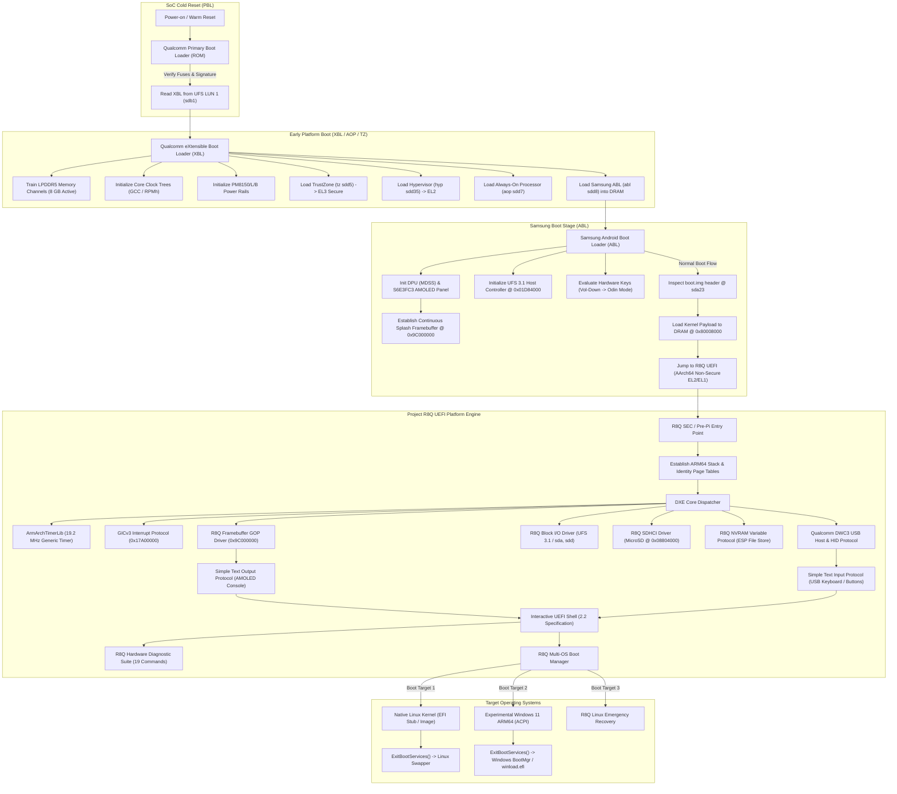

# Project R8Q UEFI: Hardware Initialization Dependency Graph

**Target Platform:** Samsung Galaxy S20 FE 5G (SM-G781B / r8q / SM8250)  
**Document Revision:** 1.0.0-M1  
**Status:** Approved Architectural Baseline  

---

## 1. System Hardware Initialization Dependency Flow

The following graph illustrates the exact chain of hardware initialization from cold reset through operating-system handoff. It delineates which components are initialized by Qualcomm firmware, Samsung ABL, R8Q UEFI, and the booted operating system.

---

## 2. Hardware Resource Ownership Matrix

The following matrix categorizes all primary hardware subsystems, identifying which entity owns initialization and runtime management.

| Subsystem | Hardware Controller | Initialized By | Owned By (UEFI) | Handed Off To |
|---|---|---|---|---|
| **CPU Cores** | Kryo 585 (Cortex-A77 + A55) | PBL / XBL | Core 0 active; 1-7 idle | Linux / Windows SMP |
| **System RAM** | 8 GB LPDDR5 (4 channels) | XBL | R8Q UEFI Page Tables | OS Memory Manager |
| **Interrupts** | ARM GICv3 (`0x17A00000`) | XBL / ABL | R8Q GIC Driver | OS Interrupt Subsystem |
| **System Timer** | ARMv8 Arch Timer (19.2 MHz) | XBL | R8Q Timer Driver | OS Scheduler Timer |
| **Display Panel** | Samsung S6E3FC3 AMOLED | ABL | GOP (Continuous Splash) | DRM KMS / Win Display |
| **Display DPU** | Qualcomm MDSS (`0x0AE00000`) | ABL | Inherited (Scanout active) | DPU driver in OS |
| **UFS Storage** | Qualcomm UFSHC (`0x01D84000`) | ABL / XBL | R8Q Block I/O Driver | OS UFS SCSI stack |
| **MicroSD Slot** | Qualcomm SDHCI (`0x08804000`) | R8Q UEFI | R8Q SDHCI Driver | OS MMC/SD subsystem |
| **USB Controller** | Synopsys DWC3 (`0x0A600000`) | R8Q UEFI | R8Q XHCI Driver | OS USB 3.0 stack |
| **PMIC / Power** | PM8150, PM8150L, PM8150B | AOP / XBL | Telemetry via SPMI | OS PMIC driver |
| **Fuel Gauge** | MAX77705 / MAX17042 | ABL | Telemetry via I2C | OS Power Supply driver |
| **Hardware Keys** | Vol-Up/Down (`gpio-keys`), Power | ABL / PMIC | R8Q Key Handler | OS Input subsystem |
| **Touchscreen** | Samsung SEC TS (`0x49` on I2C-5) | R8Q UEFI | R8Q Touch Pointer Protocol | OS Evdev / HID |
| **PCIe Controllers**| 3 × PCIe Gen3 Root Ports | XBL (partial) | Optional discovery | OS PCIe Bus Driver |

---

## 3. Critical Pre-Conditions & Constraints

1. **Non-destructive Operation:** At no point does R8Q UEFI re-initialize DDR controllers or reset power management arbiters. Doing so while running from DRAM would result in immediate CPU brownout or crash.
2. **Display Continuity:** Display DPU clocks must remain untouched during UEFI execution to maintain frame buffer scanout without panel desynchronization.
3. **Interrupt Routing:** GICv3 redistributor configurations must ensure non-secure PPIs are routed to the active exception level without disturbing secure SGIs reserved for TrustZone.

---

*Authored by Antigravity Engineering for Project R8Q UEFI.*
