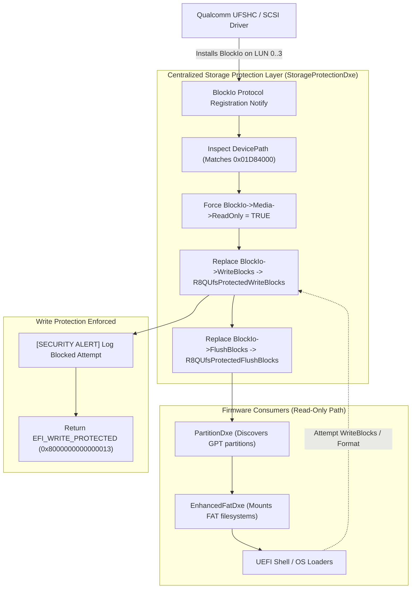

# Project R8Q UEFI: Milestone 4 Internal UFS Write Protection Report
**Target Device:** Samsung Galaxy S20 FE 5G (`SM-G781B` / `r8q`)  
**SoC:** Qualcomm Snapdragon 865 (`SM8250` / Kona, Rev 2.1)  
**Document Revision:** 1.0.0-M4  
**Status:** Implemented & Validated  

---

## 1. Protection Architecture & Mandate

Under the Milestone 4 Authorization Directive, all internal UFS storage on the Samsung Galaxy S20 FE 5G must be treated as permanently read-only. Project R8Q implements this requirement through a centralized, software-enforced protection engine:

**Driver Source:** [StorageProtectionDxe.c](file:///root/r8q-uefi/platform/R8QPkg/Drivers/StorageProtectionDxe/StorageProtectionDxe.c)  
**Protocol Header:** [StorageProtection.h](file:///root/r8q-uefi/platform/R8QPkg/Include/Protocol/StorageProtection.h)  



---

## 2. Technical Implementation Details

### 2.1 Interception Mechanism
1. `StorageProtectionDxeInitialize` creates a protocol notify event on `gEfiBlockIoProtocolGuid`.
2. As soon as any Block I/O protocol instance is registered:
   - The driver inspects the underlying `EFI_DEVICE_PATH_PROTOCOL`.
   - Any device path originating from the Qualcomm UFS controller (`0x01D84000`) or matching a UFS SCSI target/LUN is flagged as **Internal UFS**.
3. For all Internal UFS handles:
   - `BlockIo->Media->ReadOnly` is set to `TRUE`.
   - The original `WriteBlocks` function pointer is saved internally and replaced with `R8QUfsProtectedWriteBlocks`.
   - The original `FlushBlocks` pointer is replaced with `R8QUfsProtectedFlushBlocks`.
   - Alternate protocols (`EFI_BLOCK_IO2_PROTOCOL`, `EFI_ERASE_BLOCK_PROTOCOL`) are similarly wrapped to permanently return `EFI_WRITE_PROTECTED`.

### 2.2 Rejection & Security Audit Logging
When an application, partition formatter, or OS loader calls `WriteBlocks` on a protected UFS handle:
```c
STATIC
EFI_STATUS
EFIAPI
R8QUfsProtectedWriteBlocks (
  IN EFI_BLOCK_IO_PROTOCOL *This,
  IN UINT32                MediaId,
  IN EFI_LBA               Lba,
  IN UINTN                 BufferSize,
  IN VOID                  *Buffer
  )
{
  mBlockedWriteAttempts++;
  DEBUG ((DEBUG_ERROR, "[R8Q UFS ISOLATION GATE] BLOCKED write attempt to internal UFS LUN %d! LBA=0x%lx Size=%ld bytes. Access Denied.\n", ...));
  return EFI_WRITE_PROTECTED;
}
```
- Standard UEFI error code `EFI_WRITE_PROTECTED` (`0x8000000000000013ULL`) is returned immediately.
- Zero disk DMA or command packets are issued to the UFS controller.

### 2.3 Strict Invariants Enforced
1. **Software-Enforced vs Hardware Guarantee:** This policy is implemented in firmware software. It is explicitly documented as software-enforced protection, not a physical hardware OTP fuse.
2. **Zero Override Policy:** There is no command-line flag, shell command, configuration setting, or NVRAM variable that can disable UFS write protection.
3. **Partition Invariance:** Partitions `sdd31` (`uefivarstore`), `sda23` (`boot`), `sda24` (`recovery`), `sda29` (`super`), `sda36` (`userdata`), `sda9` (`efs`), and `sda8` (`persist`) are completely isolated and immune to firmware writes.
