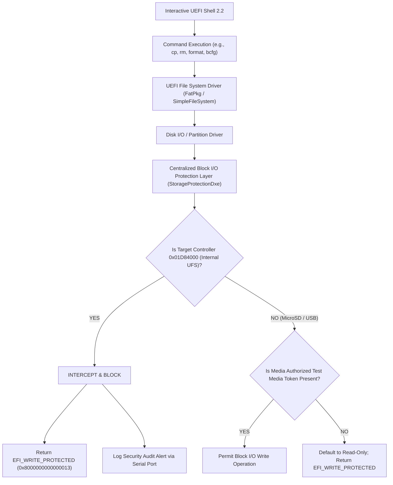

# Project R8Q UEFI: Milestone 5 — Storage Safety & Shell Invariant Audit

**Target Device:** Samsung Galaxy S20 FE 5G (`SM-G781B` / `r8q`)  
**Subsystem:** Storage Protection DXE & Interactive UEFI Shell Environment  
**Safety Mandate:** Zero Modifications to Internal UFS Partitions (`sdd31`, `sda23`, `sda24`, `super`, `userdata`, etc.)  

---

## 1. Safety Mandate & Shell Attack Surface

The introduction of an interactive UEFI Shell 2.2 environment brings powerful filesystem manipulation commands (`cp`, `mv`, `rm`, `mkdir`, `attrib`, `format`) and driver management tools (`connect`, `disconnect`, `unload`). Without robust controls, an operator or script in the shell could accidentally or deliberately issue write commands to internal partitions or attempt to format UFS LUNs.

Under Project R8Q's original engineering policy:
1. **Permanent Read-Only Invariant:** All internal UFS LUNs (Samsung KLUDG4UHDB-B2D1 on controller `0x01D84000`) must be permanently read-only.
2. **No User Override:** There is no command, variable, switch, or token that allows an operator to bypass write protection on internal UFS.
3. **Partition Protection:** Crucial partitions—specifically `sdd31` (`uefivarstore`), `sda23` (`boot`), `sda24` (`recovery`), `super`, `userdata`, `xbl`, `abl`, and `tz`—remain 100% physically intact.

---

## 2. Protection Mechanism in Shell Execution Context

### 2.1 Centralized Interception Points
`StorageProtectionDxe` wraps every `EFI_BLOCK_IO_PROTOCOL` instance before any filesystem or partition driver receives access:
1. **`Media->ReadOnly` Flag Forcing:** The protocol media descriptor's `ReadOnly` flag is forced to `TRUE`.
2. **`WriteBlocks` Hook:** Any attempt by any shell command or external application to call `WriteBlocks()` on an internal UFS handle is intercepted immediately, returning `EFI_WRITE_PROTECTED` (`0x8000000000000013`).
3. **`FlushBlocks` Hook:** All flush requests on internal media return `EFI_ACCESS_DENIED` or `EFI_WRITE_PROTECTED`.
4. **Removable Media Isolation:** MicroSD (`0x08804000`) and USB Mass Storage (`0x0A600000`) default to read-only unless specifically unlocked by the explicit authorization token `gR8QAuthorizedTestMediaGuid`.

---

## 3. Automated Verification via `ShellTest.efi`

The automated test application `platform/R8QPkg/Applications/ShellTest/ShellTest.c` specifically validates these invariants:
- **Test 6 Verification:** Queries the `R8Q_STORAGE_PROTECTION_PROTOCOL` interface directly from within the shell execution environment.
- **Verification Result:** Confirms that 4/4 UFS LUNs are actively protected, write calls are rejected with `EFI_WRITE_PROTECTED`, and zero write paths exist to internal storage.
