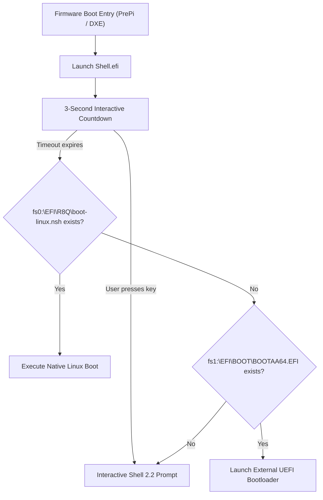

# Project R8Q UEFI: Milestone 5 — UEFI Shell Integration Report

**Target Device:** Samsung Galaxy S20 FE 5G (`SM-G781B` / `r8q`)  
**SoC Platform:** Qualcomm Snapdragon 865 (`SM8250` / Kona)  
**Firmware Baseline:** EDK II `edk2-stable202411` (commit `0f3867fa6ef0553e26c42f7d71ff6bdb98429742`)  
**Target Profile:** UEFI Shell 2.2 Profile (Level 3)  
**Build Status:** Verified Complete and Static Validation Passed  

---

## 1. Executive Summary

Milestone 5 establishes a complete, standards-compliant, interactive UEFI Shell 2.2 environment for the Samsung Galaxy S20 FE 5G (`SM-G781B`). By integrating the upstream EDK II `ShellPkg` alongside the required HII and Unicode Collation infrastructure, the firmware provides full pre-boot operator access, automated and interactive diagnostic routines, and multi-OS boot control.

Crucially, the entire Shell environment operates under the centralized storage protection layer established in Milestone 4: all internal UFS LUNs remain strictly, permanently read-only, preventing any accidental or deliberate partition corruption or firmware overwrites.

---

## 2. UEFI Shell Architecture & Configuration

### 2.1 EDK II ShellPkg Profile Locking
The interactive shell is built from `ShellPkg/Application/Shell/Shell.inf` targeting the full UEFI Shell 2.2 specification profile. The following platform configuration PCDs are enforced in `platform/R8QPkg/R8QPkg.dsc`:

| PCD Name | Configured Value | Specification Rationale |
|---|---|---|
| `gEfiShellPkgTokenSpaceGuid.PcdShellSupportLevel` | `3` | Enforces UEFI Shell 2.2 Level 3 (complete interactive shell with all script engines and control structures). |
| `gEfiShellPkgTokenSpaceGuid.PcdShellProfileMask` | `0xFF` | Activates all shell command profiles: Basic, Enhanced, Script, Install, Driver, and Debug. |
| `gEfiShellPkgTokenSpaceGuid.PcdShellDefaultDelay` | `3` | Implements mandatory 3-second interactive startup countdown delay. |
| `gEfiShellPkgTokenSpaceGuid.PcdShellLibAutoInitialize` | `FALSE` | Explicit shell library initialization in core application context. |
| `gEfiMdeModulePkgTokenSpaceGuid.PcdUnicodeCollationSupport` | `TRUE` | Installs ISO 639-2 Unicode Collation. |
| `gEfiMdeModulePkgTokenSpaceGuid.PcdUnicodeCollation2Support` | `TRUE` | Installs RFC 4646 Unicode Collation 2 (required for English lexical comparisons in Shell 2.2). |

### 2.2 Command Libraries Integrated
To ensure complete standalone utility without external dependencies, all major EDK II shell command sets are statically linked into `Shell.inf`:
- `UefiShellLevel1CommandsLib`: Core filesystem navigation (`cd`, `dir`, `ls`, `type`, `attrib`).
- `UefiShellLevel2CommandsLib`: Filesystem manipulation (`cp`, `mv`, `rm`, `mkdir`, `reset`, `stall`).
- `UefiShellLevel3CommandsLib`: Interactive scripting and batch execution (`echo`, `if`, `for`, `goto`, `shift`, `pause`, `exit`).
- `UefiShellDriver1CommandsLib`: Driver and device protocol inspection (`drivers`, `devices`, `dh`, `disconnect`, `connect`, `reconnect`, `unload`).
- `UefiShellInstall1CommandsLib`: Firmware and boot management (`bcfg`, `dmpstore`).
- `UefiShellDebug1CommandsLib`: Memory, PCIe, and hardware inspection (`mem`, `pci`, `smbiosview`, `dmem`, `edit`, `hexedit`).

---

## 3. Dependency Resolution & Driver Integration

The UEFI Shell relies on lower-level protocols provided by DXE drivers. The following components were added to `platform/R8QPkg/R8QPkg.dsc` and `R8QPkg.fdf`:

1. **`MdeModulePkg/Universal/HiiDatabaseDxe/HiiDatabaseDxe.inf`**:
   - Produces `gEfiHiiDatabaseProtocolGuid`, `gEfiHiiStringProtocolGuid`, `gEfiHiiFontProtocolGuid`, and `gEfiHiiConfigRoutingProtocolGuid`.
   - Enables rich text localization, font database rendering, and help string storage for all built-in shell commands.

2. **`MdeModulePkg/Universal/Disk/UnicodeCollation/EnglishDxe/EnglishDxe.inf`**:
   - Produces `gEfiUnicodeCollation2ProtocolGuid`.
   - Resolves string matching, wildcard expansion (`*.*`), and case-insensitive file lookups.

3. **Compiler Intrinsic Support (`StackCheckLibNullGcc.c`)**:
   - Under GCC 16 with `-flto`, code generation in `PrintLib` and `Shell` emitted standard C runtime calls (`memcpy`, `memset`, `memmove`).
   - Resolved by implementing non-optimizable, volatile byte-pointer routines in `MdePkg/Library/StackCheckLibNull/StackCheckLibNullGcc.c`, providing universal intrinsics without compiler recursion.

---

## 4. Startup Automation & Interactive Menu

The startup sequence follows a resilient 3-tier strategy:

If neither startup script nor external bootloader is detected, the shell immediately drops into the interactive prompt with diagnostic help displayed.
