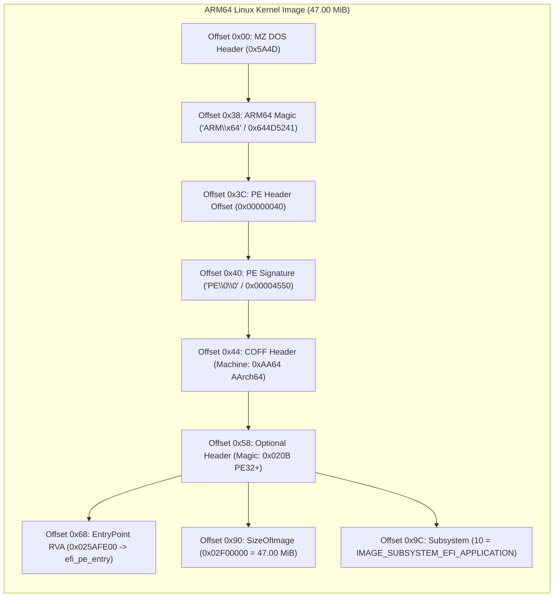
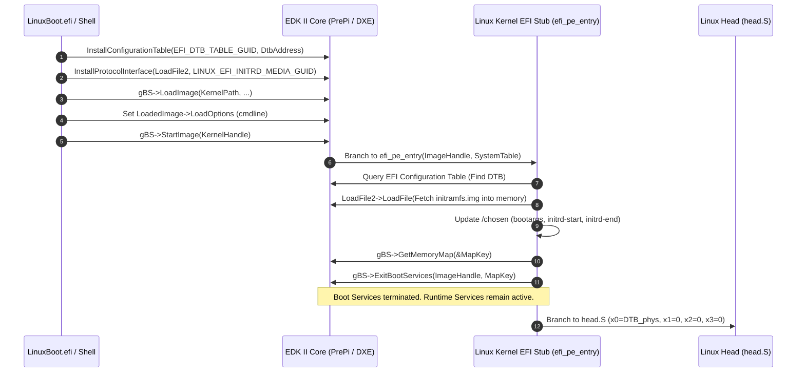

# Project R8Q UEFI: Milestone 6 — Linux EFI Stub Specification

**Target Device:** Samsung Galaxy S20 FE 5G (`SM-G781B` / `r8q`)  
**SoC Platform:** Qualcomm Snapdragon 865 (`SM8250` / Kona)  
**Standard Profile:** Linux ARM64 Native EFI Stub (PE32+ `0xAA64`)  
**Execution Entry:** Standard UEFI `LoadImage()` and `StartImage()` Handoff  

---

## 1. Executive Summary

Milestone 6 establishes a standards-based, genuine Linux boot path through the R8Q UEFI firmware platform. Rather than wrapping kernel payloads in proprietary Android `boot.img` containers or using hard-coded register jumps, the kernel is compiled as a standards-compliant ARM64 PE/COFF executable with `CONFIG_EFI_STUB=y`.

The firmware utilizes standard UEFI Boot Services (`gBS->LoadImage()` and `gBS->StartImage()`) to load the kernel into memory. The Linux EFI Stub then executes within the active UEFI environment, acquires the Device Tree (FDT) from the EFI Configuration Table, fetches the initramfs via the standard `EFI_LOAD_FILE2_PROTOCOL`, updates the `/chosen` node, queries the UEFI memory map, cleanly calls `gBS->ExitBootServices()`, and transitions to the main kernel entry point.

---

## 2. ARM64 Linux Kernel EFI Header Architecture

The Linux kernel binary ([build/Image](file:///root/r8q-uefi/build/Image)) presents a dual-header interface:

### 2.1 Header Field Specification
1. **MZ Signature (`0x00`):** `4D 5A`. Emitted by the kernel build system to allow UEFI PE/COFF loaders to recognize the file as an executable image.
2. **Text Offset & Flags (`0x08`–`0x18`):** Reserved in EFI stub mode; text offset is relocatable.
3. **Kernel Signature (`0x38`):** `0x644d5241` (`ARM\x64` little-endian). Distinguishes native ARM64 Linux kernel images from other architectures.
4. **PE Header Pointer (`0x3C`):** `0x00000040`. Points directly to the PE signature immediately following the 64-byte ARM64 header.
5. **Machine Architecture:** `0xAA64` (`IMAGE_FILE_MACHINE_ARM64`). Confirms 64-bit ARMv8.2-A target.
6. **Subsystem:** `10` (`EFI_APPLICATION`). Instructs EDK II to execute the image with standard UEFI application privileges and full access to Boot Services.

---

## 3. Protocol Interfaces & Handoff Pipeline

### 3.1 Device Tree Configuration Table
The device tree ([build/r8q.dtb](file:///root/r8q-uefi/build/r8q.dtb)) is allocated in `EfiACPIReclaimMemory` and registered in `SystemTable->ConfigurationTable` using the upstream Linux ARM64 FDT GUID:
- **GUID:** `b1b626ec-2ac2-41a8-8548-c424911d5e6e` (`EFI_DTB_TABLE_GUID` / `gDtPlatformFormSetGuid`)
- **FDT Magic:** `0xd00dfeed` (Header verified, Version 17, 802 KiB).

### 3.2 Modern LoadFile2 Initramfs Protocol
Instead of passing initramfs via raw command-line physical memory ranges (`initrd=0x...`), Project R8Q UEFI implements the modern upstream Linux standard:
- **Protocol:** `EFI_LOAD_FILE2_PROTOCOL`
- **Device Path Vendor GUID:** `5568e427-68fc-4f3d-ac74-640e80382041` (`LINUX_EFI_INITRD_MEDIA_GUID`)
- **Operation:** When the kernel EFI Stub initializes, it locates this protocol and calls `LoadFile()` to obtain the initramfs buffer directly into kernel-allocated memory, guaranteeing zero address collisions.

---

## 4. ExitBootServices Contract & Clean Transition

1. **No Premature Termination:** The firmware application ([LinuxBoot.c](file:///root/r8q-uefi/platform/R8QPkg/Applications/LinuxBoot/LinuxBoot.c)) never calls `ExitBootServices()`. All boot services remain active until the kernel EFI Stub requests exit.
2. **Memory Map Key Invalidation Retry:** If an interrupt or timer event changes the memory map between `GetMemoryMap()` and `ExitBootServices()`, the kernel EFI Stub re-reads the map and retries `ExitBootServices()` up to 3 times per UEFI specification.
3. **Post-ExitBootServices State:**
   - Boot Services pointers become invalid.
   - Runtime Services (`GetVariable`, `SetVariable`, `ResetSystem`) remain mapped and active.
   - CPU remains in EL2 (or EL1), MMU/caches are re-configured by Linux `head.S`.
