# Project R8Q UEFI: Milestone 6 — Linux Memory Reservation and Handoff

**Target Device:** Samsung Galaxy S20 FE 5G (`SM-G781B` / `r8q`)  
**SoC Platform:** Qualcomm Snapdragon 865 (`SM8250` / Kona)  
**Total DRAM:** 8.0 GB LPDDR5 (Physical Base `0x80000000`)  

---

## 1. Physical Memory Map Architecture

The Qualcomm Snapdragon 865 platform structures physical DRAM into two discrete memory banks:

```
Bank 0 (Low DRAM):  0x80000000 - 0x9FFFFFFF (512 MiB / 0x20000000 bytes)
Bank 1 (High DRAM): 0x100000000 - 0x27FFFFFFF (6144 MiB / 6.0 GiB)
```

The gap between `0x9FFFFFFF` and `0x100000000` is reserved for SoC memory-mapped I/O peripherals (`0x00000000` - `0x1FFFFFFF`) and internal hardware controllers.

---

## 2. Hardware Carveout Protection & Invariants

To avoid panics, display corruption, or TrustZone security violations, the Linux kernel device tree and UEFI memory manager must strictly preserve the following hardware carveout regions:

| Region Name | Physical Start | Size | Protection Rationale |
|---|---:|---:|---|
| `hyp_region` | `0x80000000` | `0x00600000` (6.0 MiB) | Qualcomm Hypervisor firmware. Read/Write prohibited. |
| `xbl_aop_region` | `0x80603000` | `0x0025D000` (~2.3 MiB) | Always-On Processor (AOP) & XBL firmware data. |
| `pil_tz_region` | `0x86000000` | `0x02000000` (32.0 MiB) | Qualcomm Secure Execution Environment / TrustZone OS. |
| `pil_adsp_region` | `0x8A700000` | `0x02C00000` (44.0 MiB) | Audio DSP firmware carveout. |
| `pil_slpi_region` | `0x89200000` | `0x01500000` (21.0 MiB) | Sensor Low-Power Island (SLPI) firmware carveout. |
| `pil_cdsp_region` | `0x8E300000` | `0x01A00000` (26.0 MiB) | Compute DSP / NPU firmware carveout. |
| `cont_splash_region` | `0x9C000000` | `0x02300000` (35.0 MiB) | Active AMOLED framebuffer (1080×2400 @ 32bpp). Must be preserved for SimpleDRM. |
| `disp_rdump_region` | `0x9C000000` | `0x01200000` (18.0 MiB) | Display ramdump region (overlaps splash). |
| `r8q_uefi_fv` | `0x9E400000` | `0x00400000` (4.0 MiB) | Active Project R8Q UEFI Firmware Volume (`R8Q_EFI.fd`). |

---

## 3. Kernel & Handoff Memory Allocation Strategy

```mermaid
flowchart TD
    subgraph Low_DRAM ["Low DRAM (0x80000000 - 0x9FFFFFFF: 512 MiB)"]
        direction TB
        L1["0x80000000: Hypervisor & AOP Carveout"]
        L2["0x80080000: Boot Payload Entry Window (First Stage Loader)"]
        L3["0x86000000: TrustZone / QSEE Carveout"]
        L4["0x89000000 - 0x9BFFFFFF: DSP & Modem Carveouts"]
        L5["0x9C000000 - 0x9E300000: Continuous Splash Framebuffer (35 MiB)"]
        L6["0x9E400000 - 0x9E800000: Project R8Q UEFI FV (4 MiB)"]
        L7["0x9E800000 - 0x9FFFFFFF: Conventional Memory / DTB Table"]
    end

    subgraph High_DRAM ["High DRAM (0x100000000 - 0x27FFFFFFF: 6.0 GiB)"]
        direction TB
        H1["0x100000000: Linux Kernel EFI Stub Relocation Target (47 MiB)"]
        H2["0x103000000: External Initramfs Buffer (LoadFile2 Target)"]
        H3["0x105000000 - 0x27FFFFFFF: Conventional Linux Page Pool"]
    end
```



### 3.1 Non-Overlap Invariant Proof
1. **Kernel Image Relocation:** The Linux EFI Stub allocates memory in High DRAM (`0x100000000`+), which provides a contiguous, unfragmented 6.0 GiB pool. This ensures zero risk of collisions with Low DRAM carveouts.
2. **Framebuffer Protection:** The continuous splash framebuffer at `0x9C000000` remains untouched during EFI Stub execution. Linux `simple-framebuffer` / `simpledrm` inherits this buffer directly from the DTB node.
3. **Firmware Preservation:** EDK II runtime code and data remain resident at `0x9E400000` and are reported in the UEFI memory map as `EfiRuntimeServicesCode` and `EfiRuntimeServicesData`, which Linux marks as `EFI_MEMORY_RUNTIME` and maps into its virtual address space.
