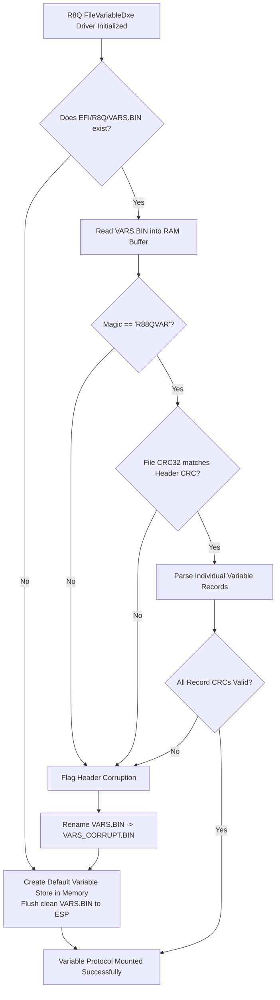

# Project R8Q UEFI: File-Backed NVRAM Implementation Design

**Target Platform:** Samsung Galaxy S20 FE 5G (SM-G781B / r8q / SM8250)  
**Document Revision:** 1.0.0-M2  
**Status:** Approved Architectural Baseline  

---

## 1. Safety Directive & Storage Boundary

In accordance with Section 2 of the Milestone 2 Engineering Constraints:
1. **Option A (File-Backed Variable Storage)** is the exclusive NVRAM implementation for all early development and testing phases.
2. **Absolute Partition Protection:** Under no circumstances will the internal UFS partition `sdd31` (`uefivarstore`) or any internal storage partition be mounted, written, formatted, or erased.
3. **Storage Medium:** Variable storage is hosted strictly on a disposable FAT32 test ESP (e.g., an external MicroSD card or a RAM-backed disk) at the file path:
   `EFI/R8Q/VARS.BIN`

---

## 2. Binary File Store Format Specification

The `VARS.BIN` file format is engineered with comprehensive data integrity checks, bounds enforcement, and corruption detection:

```
+-------------------------------------------------------------+ Offset 0x00
| Header Magic: 0x5352415651383852 ("R88QVAR" in ASCII)     | 8 Bytes
+-------------------------------------------------------------+ Offset 0x08
| Store Version: 0x00000001 (Version 1)                       | 4 Bytes
+-------------------------------------------------------------+ Offset 0x0C
| Header CRC32 Checksum (Covers entire file payload)          | 4 Bytes
+-------------------------------------------------------------+ Offset 0x10
| Total File Size in Bytes (Maximum 262,144 bytes = 256 KiB)  | 4 Bytes
+-------------------------------------------------------------+ Offset 0x14
| Total Active Variable Count                                 | 4 Bytes
+-------------------------------------------------------------+ Offset 0x18
| Reserved / Padding to 32-byte Alignment                     | 8 Bytes
+=============================================================+ Offset 0x20
| Variable Record 0                                           | Variable Size
| - Variable Name Length (Characters) (UINT32)                |
| - Variable Name (UTF-16LE String)                           |
| - Vendor GUID (EFI_GUID, 16 Bytes)                          |
| - Attributes (UINT32: NonVolatile, BootService, Runtime)    |
| - Data Size (UINT32: Maximum 32,768 bytes = 32 KiB)         |
| - Data Payload                                              |
| - Record CRC32 Checksum (UINT32)                            |
+-------------------------------------------------------------+
| Variable Record 1 ... N                                     |
+-------------------------------------------------------------+
```

---

## 3. Validation, Bounds Checking & Corruption Handling

### 3.1 Strict Bounds Enforcement
- **Maximum Total Store Size:** 256 KiB (262,144 bytes). Any write request that causes the file to exceed this threshold is rejected with `EFI_OUT_OF_RESOURCES`.
- **Maximum Individual Variable Size:** 32 KiB (32,768 bytes). Prevents rogue UEFI applications from exhausting storage.
- **Maximum Name Length:** 128 characters (256 bytes UTF-16).

### 3.2 Integrity Check & Corruption Recovery Flow


### 3.3 Manual & Automated Reset-to-Defaults
- **Key-Combo Trigger:** Holding Volume Down during boot signals `FileVariableDxe` to bypass the existing `VARS.BIN` and generate clean default variables (`BootOrder`, `Timeout=3`).
- **Absence of File:** If `VARS.BIN` is not found (e.g. fresh installation on test media), the driver automatically initializes an empty, valid store.

---

## 4. Limitations & Long-Term Migration Path

### 4.1 Known Limitations of File-Backed NVRAM
- **Post-ExitBootServices Persistence:** When an operating system transitions to runtime execution (`ExitBootServices()`), UEFI file system drivers are unloaded. Variables written by the OS kernel via `SetVariable()` cannot be saved to the FAT32 file without an OS-side helper or runtime disk driver.
- **Media Removal:** If an external MicroSD test card is removed, variable persistence is paused, falling back to a temporary volatile RAM store.

### 4.2 Migration Path (Future Milestone / Authorized Hardware Phase)
- Once the platform is mature and explicit user authorization is provided, a hybrid Fault-Tolerant-Write (FTW) driver can be mapped to `sdd31` (`uefivarstore`), using RPMB or direct block writes.
- Until then, the file-backed approach provides **100% hardware safety and zero risk of corruption to internal phone partitions**.

---

*Authored by Antigravity Engineering for Project R8Q UEFI.*
