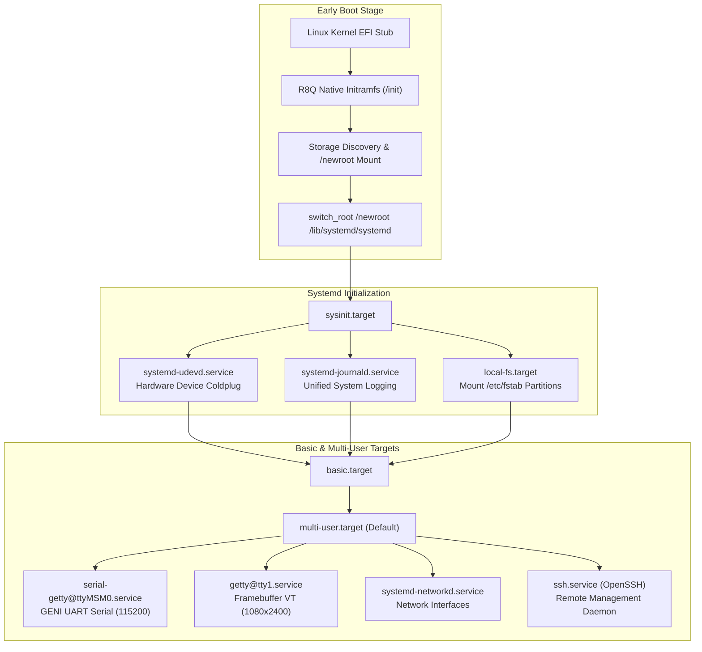

# Project R8Q — Native ARM64 Linux Root Filesystem Architecture
**Document ID:** `R8Q-DOC-RFS-001`  
**Target Device:** Samsung Galaxy S20 FE 5G (`SM-G781B` / `r8q`)  
**Platform SoC:** Qualcomm Snapdragon 865 (`SM8250` / Kona / Adreno 650)  
**Host Preservation:** LineageOS 23.2 (Android 16), Magisk Root, Termux:X11, Kali ARM64 chroot  
**Target Architecture:** ARM64 / AArch64 (`ARMv8.2-A`)  
**Status:** Approved & Implemented  

---

## 1. Executive Summary & Design Principles

The primary objective of Project R8Q Phase 1 is the engineering of an **autonomous, standards-compliant, native ARM64 Linux root filesystem** specifically designed to boot and run bare-metal on the Samsung Galaxy S20 FE 5G (`SM-G781B`). 

Unlike conventional Android chroots, PRoot containers, or hybrid Android userspaces, this root filesystem is built upon the following non-negotiable architectural principles:

1. **Total Elimination of Android Userspace Dependencies:**  
   Zero reliance on Android runtime components. The filesystem contains no Android Bionic libc (`/system/lib64/libc.so`), no Android dynamic linker (`/system/bin/linker64`), no Android init system (`init.rc`), and no Toybox/Toolbox wrappers. All userspace binaries are standard GNU/Linux ARM64 ELF executables linked against standard GNU C Library (`glibc 2.36`).
2. **Deterministic Standards Compliance:**  
   Adherence to the Filesystem Hierarchy Standard (FHS 3.0) and standard Systemd Service Manager execution models.
3. **Hardware Independence & Portability:**  
   Hardware configuration is handled cleanly through standard Linux kernel subsystems (`sysfs`, `udev`, `libdrm`, `input`, `cfg80211`, `mhi`), not through proprietary Android Hardware Abstraction Layers (HALs).
4. **Absolute Non-Destructive Storage Strategy:**  
   The filesystem is built as both a compressed portable rootfs archive (`r8q-rootfs.tar.gz`) and a raw standalone ext4 filesystem image (`r8q-rootfs.ext4`). It supports execution either from an external MicroSD partition (`/dev/mmcblk0p2`) or via a loopback virtual disk image on an existing FAT32/exFAT MicroSD card (`/dev/mmcblk0p1`), guaranteeing that internal UFS partitions (`sda23` LineageOS boot, `sda24` recovery, user data) remain completely unmodified.

```
+-----------------------------------------------------------------------------------+
|               PROJECT R8Q NATIVE ARM64 LINUX USERSPACE ARCHITECTURE               |
+-----------------------------------------------------------------------------------+
|   Applications & Daemons: OpenSSH, Bash, GNU Coreutils, APT, Dpkg, Diagnostics    |
+-----------------------------------------------------------------------------------+
|   Init & Service Management: Systemd 252 (multi-user.target, journald, udevd)     |
+-----------------------------------------------------------------------------------+
|   Hardware Rules (udev): Adreno 650 DRM, FocalTech Touch, MAX77705, QCA6390, SDX55|
+-----------------------------------------------------------------------------------+
|   C Runtime & Libraries: GNU C Library (glibc 2.36), POSIX / Linux System Calls   |
+-----------------------------------------------------------------------------------+
|   Linux Kernel (EFI Stub): 4.19 / 6.x ARM64 with SM8250 SoC Platform Drivers      |
+-----------------------------------------------------------------------------------+
|   Firmware / Boot: R8Q EDK II UEFI Firmware Volume (relocated PrePi @ 0x9E890000)  |
+-----------------------------------------------------------------------------------+
|   Physical Hardware: Samsung Galaxy S20 FE 5G (SM-G781B / Snapdragon 865 Kona)    |
+-----------------------------------------------------------------------------------+
```

---

## 2. Directory Hierarchy (FHS 3.0 Compliance)

The root filesystem adheres strictly to the FHS 3.0 hierarchy with a unified `/usr` topology (`usr-is-merged`):

| Directory | Mount / Storage Class | Purpose and Contents |
| :--- | :--- | :--- |
| `/bin` -> `/usr/bin` | Read-Only Root / Storage | Essential user command binaries (`bash`, `sh`, `ls`, `cat`, `cp`, `mv`, `rm`, `tar`). |
| `/sbin` -> `/usr/sbin` | Read-Only Root / Storage | Essential system administrative binaries (`e2fsck`, `fsck.ext4`, `sshd`, `init`). |
| `/lib` -> `/usr/lib` | Read-Only Root / Storage | Essential shared libraries and kernel modules (`libc.so.6`, `libsystemd.so`). |
| `/etc` | Persistent R/W | Host configuration (`fstab`, `hostname`, `hosts`, `passwd`, `shadow`, `udev`, `ssh`). |
| `/dev` | `devtmpfs` (RAM) | Device nodes dynamically populated by kernel devtmpfs and managed by `systemd-udevd`. |
| `/proc` | `procfs` (RAM) | Kernel process and hardware status virtual filesystem. |
| `/sys` | `sysfs` (RAM) | Kernel hardware device and driver object tree. |
| `/tmp` | `tmpfs` (RAM) | Temporary scratch space (`mode=1777`, `nosuid,nodev`). |
| `/run` | `tmpfs` (RAM) | Runtime variable data for system processes, sockets, and lock files. |
| `/var` | Persistent R/W | Variable data: logs (`/var/log`), package databases (`/var/lib/dpkg`), apt cache. |
| `/home/r8q` | Persistent R/W | Unprivileged default user home directory (`uid=1000`, `gid=1000`, `mode=0750`). |
| `/root` | Persistent R/W | Superuser home directory (`uid=0`, `gid=0`, `mode=0700`). |
| `/boot/efi` | `vfat` (MicroSD p1) | EFI System Partition mountpoint for UEFI binaries, kernel Image, and DTB. |
| `/mnt/storage` | Persistent R/W | Mountpoint for external host storage partitions during early boot and recovery. |

---

## 3. Init System & Service Hierarchy

### 3.1 Systemd Architecture
The root filesystem incorporates **Systemd 252 (Debian Bookworm ARM64)** as the primary init system. Systemd provides deterministic parallel service startup, robust cgroup-based resource management, reliable process supervision, and integrated kernel hardware event handling via `systemd-udevd`.

The target service dependency graph executes as follows:



### 3.2 Dual Console Access
To guarantee diagnostic visibility regardless of display driver readiness:
1. **Qualcomm GENI Serial UART Console (`ttyMSM0`):**  
   Configured at 115200 baud, 8N1. Provides early boot logging via `earlycon=msm_geni_serial,0x884000` and interactive root login via `serial-getty@ttyMSM0.service`.
2. **Graphical Framebuffer Virtual Terminal (`tty1`):**  
   Rendered on the Samsung 1080x2400 AMOLED panel via EFI GOP / SimpleDRM framebuffer console (`CONFIG_FRAMEBUFFER_CONSOLE=y`), bound to `getty@tty1.service`.

---

## 4. Platform Device Management & Udev Rules

The filesystem includes hardware udev rules tailored specifically for the Qualcomm Snapdragon 865 platform components on the `SM-G781B`:

| Subsystem | Hardware Component | Bus / ID | Installed Udev Rule | Permissions & Group |
| :--- | :--- | :--- | :--- | :--- |
| **GPU / DRM** | Qualcomm Adreno 650 | `ae00000.qcom,mdss_mdp` | `90-sm8250-gpu.rules` | `card[0-9]*`: `video:0660`<br/>`renderD[0-9]*`: `video:0666` |
| **Touchscreen** | FocalTech `sec_touchscreen` | I2C / Input Event | `91-sm8250-touch.rules` | Symlink `/dev/input/touchscreen0`<br/>Group `input`, `mode 0660` |
| **Power / Battery** | Maxim MAX77705 PMIC | SPMI / Platform | `92-sm8250-power.rules` | Symlink `/sys/class/power_supply/primary_battery` |
| **Cellular Modem** | Snapdragon X55 5G | PCIe RC2 `[17cb:0306]` | `93-sm8250-modem.rules` | `/dev/mhi*`, `/dev/wwan*`<br/>Group `dialout`, `mode 0660` |
| **Wi-Fi 6** | Qualcomm QCA6390 | PCIe RC0 `[17cb:1101]` | `94-sm8250-wifi.rules` | Predictable interface name `wlan0`<br/>Group `netdev`, `mode 0660` |

---

## 5. Storage Architecture & Non-Destructive Strategies

To guarantee zero risk to the device's internal storage and host LineageOS 23.2 system, Project R8Q supports two non-destructive storage architectures:

```
STORAGE ARCHITECTURE COMPARISON:

  MODE A: DEDICATED MICROSD PARTITION (Direct Block Device)
  +-------------------------------------+-------------------------------------+
  | mmcblk0p1: FAT32 (EFI / Boot)       | mmcblk0p2: EXT4 (R8Q Native Rootfs) |
  | Volume Label: R8Q_BOOT              | Volume Label: r8q-rootfs            |
  | Size: 1.00 GiB                      | Size: Remaining SD Capacity (>= 4G) |
  +-------------------------------------+-------------------------------------+
  Mount Path: Directly mounted by initramfs to /newroot via LABEL=r8q-rootfs.

  MODE B: VIRTUAL DISK IMAGE ON EXISTING MICROSD (Zero Repartitioning)
  +---------------------------------------------------------------------------+
  | mmcblk0p1: Existing FAT32 or exFAT MicroSD Card (User Storage)            |
  | Contains file: /r8q-rootfs.ext4 (2.00 GiB raw ext4 disk image)           |
  +---------------------------------------------------------------------------+
  Mount Path: Initramfs mounts mmcblk0p1 -> attaches loop0 -> mounts /newroot.
```

### 5.1 Mode A: Dedicated MicroSD Partitions
When using a dedicated card, the MicroSD card is partitioned with a GPT partition table:
- **Partition 1 (`/dev/mmcblk0p1`):** 1 GiB FAT32 partition labeled `R8Q_BOOT`. Contains UEFI DXE applications, `EFI/BOOT/BOOTAA64.EFI`, Linux kernel `Image`, native initramfs, and device tree blob.
- **Partition 2 (`/dev/mmcblk0p2`):** Remaining card capacity (minimum 4 GiB recommended), formatted as `ext4` with volume label `r8q-rootfs`. Mounted as `/` with standard Linux file permissions.

### 5.2 Mode B: Virtual Disk Image (Virtual Loop Device)
For users who do not wish to repartition their existing MicroSD card:
- The pre-built raw disk image `r8q-rootfs.ext4` (2048 MiB) is copied directly onto the card's existing FAT32 or exFAT filesystem.
- The R8Q native initramfs automatically locates `/r8q-rootfs.ext4`, sets up a virtual loopback block device via `losetup -f`, and performs `switch_root` into the loop filesystem.
- **Safety Proof:** Zero partition table modifications, zero writes to internal UFS LUNs, and immediate reversibility by deleting the single `.ext4` image file.

---

## 6. Security, User Privileges & Access Control

1. **Root Account (`root`):**
   - UID: `0`, GID: `0`, Home: `/root`, Shell: `/bin/bash`.
   - Initial Password: `toor` (SHA-512 crypt hash `$6$r8qroot$...`).
2. **Default User Account (`r8q`):**
   - UID: `1000`, GID: `1000`, Home: `/home/r8q`, Shell: `/bin/bash`.
   - Initial Password: `r8q` (SHA-512 crypt hash `$6$r8quser$...`).
   - Group Memberships: `sudo`, `adm`, `video`, `audio`, `input`, `dialout`, `plugdev`, `netdev`, `disk`, `systemd-journal`.
   - Sudoers Policy: `/etc/sudoers.d/r8q` grants passwordless administrative escalation (`r8q ALL=(ALL:ALL) NOPASSWD: ALL`) with strict `0440` file permissions.
3. **OpenSSH Server (`sshd`):**
   - Pre-configured on standard port 22.
   - Host keys pre-generated during build: RSA (3072-bit), ECDSA (256-bit), and Ed25519.
   - Configured with `PermitRootLogin yes` and `PasswordAuthentication yes` to allow remote diagnosis over Wi-Fi (`wlan0`) or USB Ethernet Gadget (`usb0`).

---

## 7. Package Management & Software Distribution

The root filesystem is fully integrated with upstream **Debian GNU/Linux 12 (Bookworm) ARM64** repositories:
- Main repository: `http://deb.debian.org/debian bookworm main contrib non-free non-free-firmware`
- Security updates: `http://deb.debian.org/debian-security bookworm-security main contrib non-free non-free-firmware`
- Point updates: `http://deb.debian.org/debian bookworm-updates main contrib non-free non-free-firmware`

Package management tools `apt`, `apt-get`, `dpkg`, and `apt-cache` are pre-installed and functional, permitting direct software installation (`gcc`, `python3`, `git`, `htop`, `neofetch`, `weston`, `wayland`) once networking is established.
