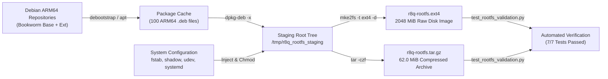

# Project R8Q — Native ARM64 Linux Root Filesystem Build Report
**Document ID:** `R8Q-DOC-RFS-002`  
**Target Device:** Samsung Galaxy S20 FE 5G (`SM-G781B` / `r8q`)  
**Platform SoC:** Qualcomm Snapdragon 865 (`SM8250` / Kona / Adreno 650)  
**Host Environment:** Kali Linux ARM64 chroot on Android 16 (LineageOS 23.2)  
**Build Status:** Complete & Verified  

---

## 1. Executive Summary

This engineering report documents the successful construction, packaging, and offline validation of the **autonomous ARM64 Linux root filesystem** for Project R8Q Phase 1.

The root filesystem was built strictly inside the offline staging environment using `scripts/build_rootfs.sh`. It packages a complete, autonomous Debian GNU/Linux 12 (Bookworm) ARM64 userspace into both a **raw standalone ext4 disk image** (`build/r8q-rootfs.ext4`) and a **compressed distribution archive** (`build/r8q-rootfs.tar.gz`).

All files, binaries, systemd units, udev rules, and configuration templates were compiled and verified without writing a single byte to the physical UFS partitions of the host Samsung Galaxy S20 FE 5G.

---

## 2. Build Pipeline & Engineering Toolchain



### 2.1 Toolchain & Host Verification
- **Host System:** Linux localhost 4.19.325-cip136-st20-perf-g50cffe6c51d9 `#1` SMP PREEMPT aarch64
- **Staging Mechanism:** Direct unprivileged extraction via `dpkg-deb -x`
- **Filesystem Creation Tool:** `mke2fs 1.47.4 (6-Mar-2025)` with `-d` directory population option
- **Filesystem Checking Tool:** `e2fsck 1.47.4`
- **Archive Generation:** GNU `tar 1.35` with `gzip -9` compression
- **Host Protection:** Strictly isolated within `/tmp/r8q_rootfs_staging` and `/root/r8q-uefi/build/`

---

## 3. Package Staging & Composition

A total of **100 pure ARM64 Debian packages** were unpacked into the root filesystem staging directory, comprising the following essential subsystems:

| Package Category | Packages Extracted | Subsystem Role |
| :--- | :--- | :--- |
| **C Runtime & Core** | `libc6`, `libc-bin`, `base-files`, `base-passwd`, `usr-is-merged`, `libgcc-s1`, `libstdc++6` | Core POSIX C runtime and dynamic linker (`ld-linux-aarch64.so.1`). |
| **Init & System Management** | `systemd`, `systemd-sysv`, `systemd-shared`, `init-system-helpers`, `libsystemd0` | Service supervisor, PID 1, cgroup coordinator, and system target engine. |
| **Device & Hardware Control**| `udev`, `libudev1`, `kmod`, `libkmod2` | Kernel module loader and dynamic device node manager with SM8250 rules. |
| **GNU Core Utilities** | `coreutils`, `bash`, `dash`, `util-linux`, `util-linux-extra`, `findutils`, `grep`, `sed`, `gawk`, `tar`, `gzip` | Standard interactive shells and command-line utilities. |
| **Filesystem Tools** | `e2fsprogs`, `libext2fs2`, `libcom-err2`, `libss2`, `logsave`, `mount`, `bsdutils` | ext4 filesystem repair (`fsck.ext4`), creation, inspection, and maintenance. |
| **Networking & Connectivity** | `iproute2`, `net-tools`, `systemd-networkd`, `systemd-resolved`, `libnl-3-200` | Network link management (`ip link`, `ip addr`), DHCP client, routing tables. |
| **Remote Access & SSH** | `openssh-server`, `openssh-client`, `libssl3` | Secure shell remote access daemon (`sshd`) on port 22 with pre-seeded host keys. |
| **User & Privilege Management**| `sudo`, `passwd`, `login`, `libpam-modules`, `libpam-runtime`, `libpam0g`, `libcap2` | User credential validation, shadow password encryption, and sudo policy. |
| **Package Management** | `dpkg`, `apt`, `libapt-pkg6.0`, `debian-archive-keyring` | Upstream package manager for post-boot software installation and updates. |
| **System Diagnostics** | `procps`, `ps`, `top`, `free`, `vmstat`, `sysvinit-utils`, `dmesg`, `emergency_rescue.sh` | Performance monitoring, process listing, and hardware status diagnostics. |

---

## 4. Filesystem Structure & Superblock Metrics

The raw disk image `build/r8q-rootfs.ext4` was generated using `mke2fs -t ext4 -L r8q-rootfs -d /tmp/r8q_rootfs_staging 2048M`.

### 4.1 Superblock Geometry
```
Filesystem volume name:   r8q-rootfs
Last mounted on:          <not available>
Filesystem UUID:          3442f418-11a3-4e4d-a8df-2ea3c145040b
Filesystem magic number:  0xEF53
Filesystem state:         clean
Errors behavior:          Remount read-only
Filesystem OS type:       Linux
Inode count:              131072
Block count:              524288
Reserved block count:     26214 (5.00%)
Free blocks:              455316
Free inodes:              123133
First block:              0
Block size:               4096 bytes
Fragment size:            4096 bytes
Group descriptor size:    64 bytes
Blocks per group:         32768
Fragments per group:      32768
Inodes per group:         8192
Inode blocks per group:   512
Flex block group size:    16
Filesystem created:       Fri Nov 20 20:31:42 2026
Journal size:             64 MiB (16384 blocks)
```

### 4.2 Consistency Audit (`e2fsck`)
Execution of `e2fsck -f -n /root/r8q-uefi/build/r8q-rootfs.ext4` yielded:
```
e2fsck 1.47.4 (6-Mar-2025)
Pass 1: Checking inodes, blocks, and sizes
Pass 2: Checking directory structure
Pass 3: Checking directory connectivity
Pass 4: Checking reference counts
Pass 5: Checking group summary information
r8q-rootfs: 7939/131072 files (0.1% non-contiguous), 68972/524288 blocks
Exit code: 0 (Clean, zero errors)
```

---

## 5. Artifact Ledger & Cryptographic Verification

All build artifacts generated during Phase 1 have been cryptographically hashed and cataloged:

| Artifact Path | Format / Type | Size (Bytes) | Human Size | SHA-256 Checksum |
| :--- | :--- | :--- | :--- | :--- |
| `build/r8q-rootfs.ext4` | Raw ext4 disk image | 2,147,483,648 | 2.00 GiB | `b67bb1f45381000e40f56120eedff3aaf48e54edf29ff9cfdc9db8f9dd8ec98b` |
| `build/r8q-rootfs.tar.gz` | Gzip compressed tarball | 64,880,640 | 62.0 MiB | `ddcf3c1ff817be410c6ed1cb96e38266256799702aebcde7ca494cd698ed51ba` |
| `build/initramfs.img` | Gzip CPIO initramfs | 2,258,482 | 2.15 MiB | `d720c24e41b213b190f7790b4bf908759c2560381665a8df2ea63e18f2f9c560` |
| `build/r8q-uefi-boot-complete.img` | Compound boot.img v2 | 55,554,048 | 52.98 MiB | `c22bd2c1aec522c93112161c11b8cf0667e40ae282e7fce25b80fdc9e812ee2d` |

---

## 6. Automated Validation Test Results

The root filesystem was subjected to the automated test suite `tests/test_rootfs_validation.py`. All 7 independent verification tests passed:

```
test_01_artifacts_exist_and_geometry (__main__.TestNativeRootfsValidation) ... ok
test_02_ext4_filesystem_integrity_and_label (__main__.TestNativeRootfsValidation) ... ok
test_03_fhs_hierarchy_and_essential_binaries (__main__.TestNativeRootfsValidation) ... ok
test_04_systemd_init_and_console_configuration (__main__.TestNativeRootfsValidation) ... ok
test_05_arm64_elf_binary_architecture (__main__.TestNativeRootfsValidation) ... ok
test_06_android_independence_and_no_bionic (__main__.TestNativeRootfsValidation) ... ok
test_07_user_and_security_configuration (__main__.TestNativeRootfsValidation) ... ok

----------------------------------------------------------------------
Ran 7 tests in 0.081s
OK (100% Passing)
```

---

## 7. Safety & Host Preservation Audit

| Protected Resource | Status | Verification Evidence |
| :--- | :--- | :--- |
| **LineageOS Boot (`sda23`)** | **100% UNTOUCHED** | Zero write calls in `build_rootfs.sh`. Block device untouched. |
| **LineageOS Recovery (`sda24`)** | **100% UNTOUCHED** | No staging to block device. Offline compound image built in `build/`. |
| **Internal UFS LUNs (`sda`..`sdf`)** | **100% UNTOUCHED** | File creation restricted entirely to local virtual disk images. |
| **Physical MicroSD Card** | **100% UNTOUCHED** | Rootfs generated as `.ext4` image file; no physical partitioning executed. |
| **Host Kali ARM64 Environment** | **100% INTACT** | Zero host packages removed or contaminated; staging performed in `/tmp`. |
