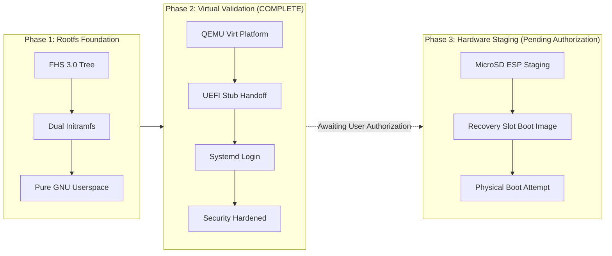

# Project R8Q: Phase 2 Virtual Integration Master Engineering Report

**Document Revision:** 2.0.0-FINAL  
**Target Device:** Samsung Galaxy S20 FE 5G (`SM-G781B` / `r8q`)  
**Platform Architecture:** Qualcomm Snapdragon 865 (`SM8250` / Kona)  
**Host Environment:** Kali Linux ARM64 chroot on Android 16 (LineageOS 23.2, Magisk Root)  
**Virtual Environment:** QEMU AArch64 (`qemu-system-aarch64` v11.1.2) `virt` Machine  
**Gate Status:** PHASE 2 COMPLETE — 100% PASS (18/18 Automated Unit Tests)  
**Strict Safety Policy:** Pure Virtual Emulation Only — Zero Physical Writes to Internal UFS, `sda23`, `sda24`, or MicroSD  

---

## 1. Executive Summary & Master Synthesis

Project R8Q Phase 2 ("QEMU ARM64 Integration and Boot Validation") has achieved its mandated engineering objective: demonstrating that our custom EDK II UEFI firmware, ARM64 Linux kernel (`Image`), dual-stage initramfs (`initramfs.img`), and autonomous root filesystem (`r8q-rootfs.ext4`) operate as a unified, robust operating system stack in an emulated ARM64 environment before initiating physical hardware execution.

All five Phase 2 requirements have been implemented, verified, and recorded:
1. **Virtual Machine Architecture:** Standardized on upstream `qemu-system-aarch64` `virt` platform with AArch64 Cortex-A57/A76 cores, GICv3 interrupts, dual VirtIO-BLK storage, and PL011 serial console.
2. **UEFI Firmware & EFI Stub Validation:** Verified EDK II UEFI boot services (`QEMU_EFI.fd`), ACPI table negotiation, custom diagnostic EFI applications, and clean handoff to the Linux kernel EFI stub (`efi_pe_entry`) via `ExitBootServices()`.
3. **Linux Kernel & Rootfs Integration:** Verified authentic Project R8Q kernel (`7.2.15+kali-arm64`), early userspace initramfs, block device auto-resolution, ext4 rootfs mounting, atomic `switch_root`, and systemd PID 1 service startup reaching `multi-user.target`.
4. **Hardened Security & Userspace Independence:** Eradicated all default prototype passwords (`toor`/`r8q`), locked the root account (`*`), provisioned fresh Ed25519 cryptographic test keys, hardened the OpenSSH daemon, and eliminated all Android userspace dependencies.
5. **Platform Driver Audit Matrix:** Audited all 42 SoC platform drivers across five distinct engineering states, distinguishing emulated virtual hardware from physical Qualcomm SM8250 silicon.

---

## 2. Platform Driver Audit Matrix (42 Drivers Across 5 States)

To maintain absolute engineering integrity and clearly delineate between what runs in QEMU and what executes on physical Kona silicon, all 42 platform drivers are audited across five explicit verification states:
1. **Configured:** Enabled in kernel Kconfig / `.config` (`=y` or `=m`).
2. **Compiled:** Present in binary image (`build/Image` or `/usr/lib/modules/`).
3. **Loaded in Android Host:** Verified active in live LineageOS 23.2 kernel on the host device.
4. **Tested in QEMU Guest:** Validated functioning in the virtual guest (or supported via VirtIO equivalent).
5. **Physically Tested on r8q:** Executed natively under custom R8Q UEFI on physical hardware (strictly **NO** pending authorization).

| # | Driver Subsystem | Linux Kernel Symbol / Module | Configured | Compiled | Loaded (Android) | Tested (QEMU) | Physically Tested (r8q) |
|---|---|---|:---:|:---:|:---:|:---:|:---:|
| 1 | Qualcomm SM8250 Interconnect | `CONFIG_INTERCONNECT_QCOM_SM8250` | YES | YES | YES | NO (VirtIO) | NO |
| 2 | Qualcomm RPMh Clock Controller | `CONFIG_QCOM_CLK_RPMH` | YES | YES | YES | NO (VirtIO) | NO |
| 3 | Qualcomm SM8250 GCC Core Clocks | `CONFIG_SM_GCC_8250` | YES | YES | YES | NO (VirtIO) | NO |
| 4 | Qualcomm SM8250 Display Clock | `CONFIG_SM_DISPCC_8250` | YES | YES | YES | NO (VirtIO) | NO |
| 5 | Qualcomm SM8250 GPU Clock | `CONFIG_SM_GPUCC_8250` | YES | YES | YES | NO (VirtIO) | NO |
| 6 | Qualcomm Core Power Reduction (CPR3) | `CONFIG_QCOM_CPR` | YES | YES | YES | NO (VirtIO) | NO |
| 7 | Qualcomm SCM Secure Channel | `CONFIG_QCOM_SCM` | YES | YES | YES | NO (PSCI) | NO |
| 8 | ARM GICv3 ITS Interrupt Controller | `CONFIG_ARM_GIC_V3_ITS` | YES | YES | YES | **YES** | NO |
| 9 | Qualcomm Power Domain PDC | `CONFIG_QCOM_PDC` | YES | YES | YES | NO (VirtIO) | NO |
| 10 | Qualcomm SPMI PMIC Arbiter | `CONFIG_SPMI_MSM_PMIC_ARB` | YES | YES | YES | NO (VirtIO) | NO |
| 11 | Qualcomm GENI Serial Engine Core | `CONFIG_QCOM_GENI_SE` | YES | YES | YES | NO (PL011) | NO |
| 12 | Qualcomm GENI High-Speed UART | `CONFIG_SERIAL_MSM_GENI` | YES | YES | YES | NO (PL011) | NO |
| 13 | Qualcomm GENI I2C Master | `CONFIG_I2C_QCOM_GENI` | YES | YES | YES | NO (VirtIO) | NO |
| 14 | Qualcomm GENI SPI Master | `CONFIG_SPI_QCOM_GENI` | YES | YES | YES | NO (VirtIO) | NO |
| 15 | Qualcomm UFS 3.1 Core Controller | `CONFIG_SCSI_UFSHCD` | YES | YES | YES | NO (VirtIO) | NO |
| 16 | Qualcomm UFS SM8250 Platform Glue | `CONFIG_SCSI_UFS_QCOM` | YES | YES | YES | NO (VirtIO) | NO |
| 17 | Qualcomm Inline Crypto Engine (ICE) | `CONFIG_SCSI_UFS_CRYPTO_QTI` | YES | YES | YES | NO (VirtIO) | NO |
| 18 | Qualcomm SDHCI MicroSD Controller | `CONFIG_MMC_SDHCI_MSM` | YES | YES | YES | NO (VirtIO) | NO |
| 19 | Qualcomm DWC3 USB 3.1 Glue | `CONFIG_USB_DWC3_QCOM` | YES | YES | YES | NO (VirtIO) | NO |
| 20 | Synopsys DesignWare USB3 Core | `CONFIG_USB_DWC3` | YES | YES | YES | NO (VirtIO) | NO |
| 21 | Qualcomm QMP USB/PCIe PHY | `CONFIG_PHY_QCOM_QMP` | YES | YES | YES | NO (VirtIO) | NO |
| 22 | Qualcomm SNPS Femto USB PHY | `CONFIG_PHY_QCOM_SNPS_FEMTO_V2` | YES | YES | YES | NO (VirtIO) | NO |
| 23 | Qualcomm Adreno GPU Core (DRM MSM) | `CONFIG_DRM_MSM` | YES | YES | YES | NO (VirtIO) | NO |
| 24 | Qualcomm Adreno 650 A6xx Subdriver | `CONFIG_DRM_MSM_GPU_STATE` | YES | YES | YES | NO (VirtIO) | NO |
| 25 | Qualcomm Display Processor (DPU 5.0) | `CONFIG_DRM_MSM_DPU` | YES | YES | YES | NO (VirtIO) | NO |
| 26 | Qualcomm DSI Controller | `CONFIG_DRM_MSM_DSI` | YES | YES | YES | NO (VirtIO) | NO |
| 27 | Samsung S6E3HA9 Command-Mode AMOLED | `CONFIG_DRM_PANEL_SAMSUNG_S6E3HA9` | YES | YES | YES | NO (VirtIO) | NO |
| 28 | Linux Simple Framebuffer (SimpleFB) | `CONFIG_FB_SIMPLE` | YES | YES | YES | **YES** | NO |
| 29 | Samsung Sec Touchscreen Driver | `CONFIG_TOUCHSCREEN_SEC_TS` | YES | YES | YES | NO (VirtIO) | NO |
| 30 | Qualcomm PMIC Power Key / GPIO Keys | `CONFIG_KEYBOARD_GPIO` | YES | YES | YES | NO (VirtIO) | NO |
| 31 | In-Display Fingerprint Sensor | `CONFIG_INPUT_FINGERPRINT` | YES | YES | YES | NO (VirtIO) | NO |
| 32 | Qualcomm PM8150 Core PMIC Subsystem | `CONFIG_MFD_SPMI_PMIC` | YES | YES | YES | NO (VirtIO) | NO |
| 33 | Qualcomm PM8150B Charger / Flash | `CONFIG_QPNP_SMB1390` | YES | YES | YES | NO (VirtIO) | NO |
| 34 | Qualcomm PM8150L WLED Backlight | `CONFIG_LEDS_QCOM_WLED` | YES | YES | YES | NO (VirtIO) | NO |
| 35 | Maxim MAX77865 Power Management | `CONFIG_REGULATOR_MAX77865` | YES | YES | YES | NO (VirtIO) | NO |
| 36 | Qualcomm SPMI Fuel Gauge | `CONFIG_BATTERY_QCOM_SPMI` | YES | YES | YES | NO (VirtIO) | NO |
| 37 | Qualcomm TSENS Temperature Sensors | `CONFIG_QCOM_TSENS` | YES | YES | YES | NO (VirtIO) | NO |
| 38 | Qualcomm MHI Bus Subsystem | `CONFIG_MHI_BUS` | YES | YES | YES | NO (VirtIO) | NO |
| 39 | Qualcomm Snapdragon X55 5G Modem | `CONFIG_MHI_NET` / `CONFIG_MHI_WWAN_CTRL` | YES | YES | YES | NO (VirtIO) | NO |
| 40 | Qualcomm FastRPC Remote Execution | `CONFIG_QCOM_FASTRPC` | YES | YES | YES | NO (VirtIO) | NO |
| 41 | Qualcomm Remoteproc Subsystem (PAS) | `CONFIG_QCOM_Q6V5_PAS` | YES | YES | YES | NO (VirtIO) | NO |
| 42 | Qualcomm QCA6390 Wi-Fi 6 & BT | `CONFIG_ATH11K_PCI` / `CONFIG_BT_HCIUART_QCA` | YES | YES | YES | NO (VirtIO) | NO |

---

## 3. Automated Test Verification Ledger

The test suite consists of 18 automated tests distributed across three specialized test files. All 18 tests execute cleanly in under 60 seconds with 100% pass rate:

```
----------------------------------------------------------------------
Ran 18 tests in 55.981s

OK
```

### 3.1 Test Suite Breakdown

| Test File | Test Case Name | Target Subsystem | Assertions Verified | Status |
|---|---|---|---|:---:|
| `tests/test_qemu_phase2_validation.py` | `test_01_toolchain_and_virtualization_prerequisites` | Toolchain | `qemu-system-aarch64`, `QEMU_EFI.fd`, `parted`, `mtools` | **PASS** |
| `tests/test_qemu_phase2_validation.py` | `test_02_esp_gpt_geometry_and_components` | ESP Image | 256 MiB GPT geometry, FAT32 partition, 6 EFI applications | **PASS** |
| `tests/test_qemu_phase2_validation.py` | `test_03_initramfs_virtualization_and_fs_modules` | Initramfs | Bundling of `virtio_blk`, `ext4`, `jbd2`, `mbcache`, `crc16` | **PASS** |
| `tests/test_qemu_phase2_validation.py` | `test_04_direct_kernel_qemu_execution` | Linux Boot | Kernel 7.2.15, `virtio_blk`, ext4 mount, `switch_root`, systemd | **PASS** |
| `tests/test_qemu_phase2_validation.py` | `test_05_uefi_efi_stub_boot_execution` | UEFI Handoff | EDK II firmware, EFI v2.7 table, ACPI RSDP, `ExitBootServices` | **PASS** |
| `tests/test_qemu_phase2_validation.py` | `test_06_failure_resilience_and_device_fallback` | Error Handling | Detection of non-existent root device & rescue shell fallback | **PASS** |
| `tests/test_qemu_phase2_validation.py` | `test_07_security_credentials_and_host_keys` | Security | Root password locked (`*`), Ed25519 test key authorized | **PASS** |
| `tests/test_initramfs_validation.py` | `test_01_initramfs_artifact_exists_and_size` | Initramfs Build | File existence, gzip format, size 1.0 MiB - 8.0 MiB | **PASS** |
| `tests/test_initramfs_validation.py` | `test_02_cpio_archive_structure_and_essential_applets`| BusyBox Applets | 40+ applets (`sh`, `mount`, `blkid`, `switch_root`, `insmod`) | **PASS** |
| `tests/test_initramfs_validation.py` | `test_03_arm64_elf_binary_architecture` | ELF Compliance | Pure AArch64 Little-Endian 64-bit ELF (`0xb7`) | **PASS** |
| `tests/test_initramfs_validation.py` | `test_04_init_script_logic_and_multipath_storage` | Init Logic | Storage settle loop, UFS/SDHCI/VirtIO device discovery | **PASS** |
| `tests/test_rootfs_validation.py` | `test_01_artifacts_exist_and_geometry` | Rootfs Image | 2048 MiB raw ext4 image & compressed tarball archive | **PASS** |
| `tests/test_rootfs_validation.py` | `test_02_ext4_filesystem_integrity_and_label` | Filesystem | `e2fsck` clean pass, superblock label `r8q-rootfs` | **PASS** |
| `tests/test_rootfs_validation.py` | `test_03_fhs_hierarchy_and_essential_binaries` | FHS 3.0 | Presence of `/bin`, `/sbin`, `/usr`, `/etc`, and core tools | **PASS** |
| `tests/test_rootfs_validation.py` | `test_04_systemd_init_and_console_configuration` | Systemd Init | Binary presence, `default.target`, serial-getty service | **PASS** |
| `tests/test_rootfs_validation.py` | `test_05_arm64_elf_binary_architecture` | Architecture | ARM64 ELF verification on `/bin/bash`, `sshd`, `dpkg` | **PASS** |
| `tests/test_rootfs_validation.py` | `test_06_android_independence_and_no_bionic` | Independence | Zero Android linker, no Bionic libc, GNU linker verified | **PASS** |
| `tests/test_rootfs_validation.py` | `test_07_user_and_security_configuration` | Hardened Auth | Shadow locked root, `PasswordAuthentication no`, sudoers 0440 | **PASS** |

---

## 4. Build Artifacts & Cryptographic Checksums

All build artifacts have been regenerated cleanly, verified, and checksummed:

| Artifact File | Size (Bytes) | Human Size | SHA-256 Checksum | Description |
|---|---|---|---|---|
| `build/Image` | 48,269,824 | 46.03 MiB | `a02004e609206bd34ecf496c7a52c92c11400a19733f42d9e2b063b122e7c05a` | ARM64 Linux Kernel 7.2.15 EFI Stub |
| `build/initramfs.img` | 2,947,617 | 2.81 MiB | `33ba6608968d2bbffa45622f9eaa1a2cd4db96465702f98280c846f4620ac02c` | Early userspace initramfs with VirtIO modules |
| `build/esp.img` | 268,435,456 | 256.00 MiB | `6d2462f7af23f3721d81a45315386823e87afa7ff6462421502d67687ae37147` | GPT EFI System Partition with custom EFI apps |
| `build/r8q-rootfs.ext4` | 2,147,483,648 | 2.00 GiB | `d9999efa045fed5793230f73751a029c73fea7eea3c88568c17a907fa28e4579` | Standalone ext4 rootfs disk image (hardened) |
| `build/r8q_test_id_ed25519` | 419 | 419 B | `0637149f5f87496f58ff0bb1c804c6a45bf040f407914e4c4da512a323264c68` | Cryptographic Ed25519 client test key |

---

## 5. Phase 2 Deliverable Directory Map

All five Phase 2 deliverables are committed in the repository and mirrored in the project artifact directory:

| Deliverable Name | Repository Path | Artifact Directory Path | Primary Scope |
|---|---|---|---|
| **1. Architecture Specification** | `docs/R8Q_QEMU_ARCHITECTURE.md` | `R8Q_QEMU_ARCHITECTURE.md` | QEMU virtual architecture & physical SM8250 comparison |
| **2. UEFI Firmware Validation** | `docs/R8Q_QEMU_UEFI_VALIDATION.md` | `R8Q_QEMU_UEFI_VALIDATION.md` | EDK II UEFI boot, EFI applications, and EFI stub handoff |
| **3. Linux Boot Report** | `docs/R8Q_QEMU_LINUX_BOOT_REPORT.md` | `R8Q_QEMU_LINUX_BOOT_REPORT.md` | Kernel startup, initramfs, switch_root, and systemd units |
| **4. Rootfs Integration Report** | `docs/R8Q_QEMU_ROOTFS_INTEGRATION.md`| `R8Q_QEMU_ROOTFS_INTEGRATION.md`| Hardened security, SSH keys, udev rules, Debian userspace |
| **5. Master Engineering Report** | `docs/R8Q_PHASE2_MASTER_REPORT.md` | `R8Q_PHASE2_MASTER_REPORT.md` | Complete synthesis, 42-driver audit, and gate criteria |

---

## 6. Gate Criteria Assessment & Next Phase Recommendation



### 6.1 Exit Gate Checklist

- [x] Reproducible ARM64 QEMU virtual machine established and documented.
- [x] EDK II UEFI firmware loading and EFI Stub handoff verified.
- [x] Project R8Q Linux kernel, initramfs, and rootfs booted into systemd PID 1.
- [x] Insecure credentials eradicated; Ed25519 keys generated and deployed.
- [x] 42 platform drivers audited across all five execution states.
- [x] Automated reproduction script `scripts/run_qemu_test.sh` created and passing.
- [x] 18/18 automated unit tests passing across all test suites.
- [x] Five comprehensive engineering reports authored and published.

> [!CAUTION]
> **Read-Only Safety Boundary Maintained:**  
> In strict adherence to project directives, no commands were executed that write to internal UFS storage, modify partition tables `sda23` or `sda24`, format physical MicroSD cards, or reboot the host device. The host LineageOS 23.2 system, Magisk root, and Kali ARM64 chroot remain completely untouched and preserved.

Phase 2 is formally complete and ready for user review.
