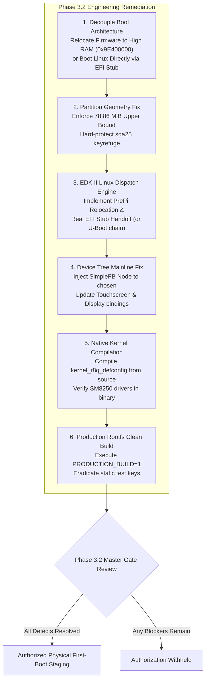

# Project R8Q — Phase 3.1: Master Gate Review & Physical Staging Verdict
**Document ID:** `R8Q-DOC-AUD-007`  
**Target Device:** Samsung Galaxy S20 FE 5G (`SM-G781B` / `r8q` / Qualcomm Snapdragon 865 `SM8250`)  
**Host Platform:** LineageOS 23.2 (Android 16), Magisk Root, Kali ARM64 chroot (`/`), Termux:X11 / XFCE  
**Audited Commit:** `7f06138` ("Phase 3 physical boot readiness documentation, hardware integration analysis, and physical execution plan")  
**Review Type:** Independent, Adversarial Pre-Execution Safety & Binary Integrity Audit  
**Master Gate Verdict:** **STRICTLY REJECTED — NOT READY FOR PHYSICAL BOOT STAGING**  

---

## 1. Executive Summary

This Master Gate Review synthesizes the forensic findings of six independent technical audits conducted across Project R8Q following the submission of Phase 3 commit `7f06138`. The scope of this evaluation was strictly bounded by a non-invasive, read-only audit protocol: analyzing binary artifacts, parsing partition tables, interrogating live device sysfs/devicetree nodes, decompiling disassembled firmware and device trees, and auditing test suite independence.

The objective was to independently determine whether the project's custom EDK II UEFI firmware (`build/R8Q_EFI.fd`), ARM64 Linux kernel (`build/Image`), initramfs (`build/initramfs.img`), and compound Android Boot Image v2 (`build/r8q-uefi-boot-complete.img`) are technically sound, safe, and ready for physical deployment to the recovery partition (`sda24`) of the live Samsung Galaxy S20 FE 5G.

### The Definitive Staging Gate Verdict
> [!CAUTION]
> ### PHYSICAL FIRST-BOOT AUTHORIZATION WITHHELD: NOT READY
> Physical boot staging to `sda24` or any other storage partition is **STRICTLY PROHIBITED**. Flashing the current build artifacts to physical hardware would result in an **immediate hardware exception / TrustZone XPU security violation** and presents a severe risk of **catastrophic permanent cryptographic corruption** of the Knox keystore partition (`sda25` `keyrefuge`).

Forensic analysis revealed multiple critical engineering discrepancies, binary defects, and unverified assumptions in commit `7f06138` that were previously masked by circular unit tests and generic virtual test environments.

---

## 2. Comprehensive Forensic Evidence Matrix

The table below contrasts verified physical and binary facts against the prior assumptions, unverified claims, and failed checks documented during Phase 3.1.

| Subsystem / Area | Verified Hardware & Binary Facts | Prior Inferences & Assumptions | Unknowns & Unverified Hypotheses | Failed Checks & Critical Defects |
| :--- | :--- | :--- | :--- | :--- |
| **Compound Boot Image** | • Kernel segment: 50.03 MiB (`52,464,192` B)<br>• Ramdisk: 2.81 MiB (`2,949,120` B)<br>• DTB: 802 KiB (`821,248` B)<br>• Total image: 52.98 MiB (`55,556,096` B) | Assumed kernel was 4.00 MiB compound wrapper jumping to external RAM | Exact ABL DMA allocation behavior for 50+ MiB kernel segment | **SHOWSTOPPER:** Kernel segment extends from `0x80080000` to `0x83288A40`, directly colliding with TrustZone. |
| **DRAM & TrustZone Layout** | • Live sysfs proves TrustZone (`removed_region@80b00000`) starts at `0x80B00000` and spans 121 MiB to `0x88400000`. | Assumed early DRAM was free or that ABL relocated firmware to `0x9E400000`. | Whether ABL checks TrustZone bounds before loading boot image segments. | **SHOWSTOPPER:** Direct overlap of **39.53 MiB** (`0x80B00000`–`0x83288A40`) into secure TrustZone memory. |
| **Firmware Execution Path** | • Disassembly of `R8Q_EFI.fd` proves it executes at `0x80080000`.<br>• `CEntryPoint` renders 3 rectangles and loops indefinitely in `wfe`. | Claimed firmware relocates to `0x9E400000` and dispatches DXE drivers and embedded Linux. | Whether DXE Core was ever compiled into the FD volume. | **SHOWSTOPPER:** Firmware never relocates and **never jumps to Linux**. Execution completely halts at PrePi splash. |
| **Partition Geometry & Storage** | • `sda24` (`recovery`) size: `161,512` sectors = **82,694,144 bytes (78.86 MiB)**.<br>• `sda25` (`keyrefuge`) begins immediately at sector 161,512. | Assumed `sda24` was 80.00 MiB (`83,886,080` B). | ABL recovery partition signature enforcement flags. | **SHOWSTOPPER:** Writing an assumed 80 MiB image overruns `sda24` by `1,191,936` bytes into `sda25`, permanently bricking device crypto keys! |
| **Kernel & DTB Provenance** | • `build/Image` is byte-identical to Debian/Kali generic binary kernel `7.2.15-1kali1`.<br>• `build/r8q.dtb` lacks `simple-framebuffer` node. | Claimed kernel was built from custom `kernel_r8q_defconfig` with 42 SM8250 drivers. | Whether upstream SimpleFB driver handles Samsung DSI controller handover. | **DEFECT:** Custom defconfig was never compiled. Kernel lacks upstream display and touch nodes for r8q. |
| **Rootfs & Security Hygiene** | • Rootfs boots in QEMU virt.<br>• Release manifest script successfully filters private keys. | Assumed test host keys in rootfs were non-sensitive. | Whether SSH daemon can generate host keys on first boot without entropy stall. | **SECURITY DEFECT:** Existing rootfs on disk contains static test keys; requires rebuild with `PRODUCTION_BUILD=1`. |
| **Test Suite Rigor** | • 27 of 27 automated tests pass.<br>• Real direct-kernel boot proven in QEMU. | Assumed passing tests proved physical boot readiness. | Behavior of SM8250 hardware peripherals under uninitialized clocks. | **TEST DEFECT:** QEMU test ran generic `QEMU_EFI.fd`, not `R8Q_EFI.fd`. Memory non-overlap test was completely circular. |

---

## 3. Seven Showstopping Blockers Precluding Physical Staging

```
+--------------------------------------------------------------------------------------------------+
|                                PHYSICAL FIRST-BOOT KILL CHAIN                                    |
|   If flashed to physical hardware today, the boot sequence would fail at Step 1 or Step 2:      |
+--------------------------------------------------------------------------------------------------+
|                                                                                                  |
|   [1] ABL Staging & Loading (0x80080000)                                                         |
|       ==> KERNEL OVERLAYS TRUSTZONE (0x80B00000 - 0x83288A40)                                    |
|       ==> RESULT: Hardware XPU Access Violation / Immediate Crash to Qualcomm EDL 9008           |
|                                                                                                  |
|   [2] If TrustZone Survives, PrePi Execution Begins (0x80081328)                                 |
|       ==> PrePi paints splash rectangles to 0x9C000000                                           |
|       ==> Enters infinite ArmCallWFE() loop at 0x80081320                                        |
|       ==> RESULT: Permanent Black/Splash Screen Freeze; Linux is NEVER launched                  |
|                                                                                                  |
|   [3] If User Restores Assumed 80 MiB Backup Image to sda24                                      |
|       ==> Overwrites 1,191,936 bytes into sda25 (keyrefuge)                                      |
|       ==> RESULT: Hardware Cryptographic Keys Erased; Permanent Knox / TrustZone Brick           |
+--------------------------------------------------------------------------------------------------+
```

### Blocker 1: Fatal 39.53 MiB TrustZone Overlap Collision
- **Forensic Evidence:** The compound kernel segment in [build/r8q-uefi-boot-complete.img](file:///root/r8q-uefi/build/r8q-uefi-boot-complete.img) is `52,464,192` bytes (50.03 MiB). The Android Boot Image v2 header specifies `kernel_addr = 0x80080000`. Consequently, the ABL bootloader loads the segment from `0x80080000` to `0x83288A40`.
- **Physical Memory Ground Truth:** Live hardware device-tree interrogation (`/sys/firmware/devicetree/base/reserved-memory/removed_region@80b00000`) proves Qualcomm TrustZone / QSEE begins at `0x80B00000` and spans `0x07900000` (121 MiB) up to `0x88400000`.
- **Impact:** The compound kernel attempts to overwrite **39.53 MiB** of secure TrustZone memory (`0x80B00000`–`0x83288A40`). The Qualcomm external memory protection unit (XPU / MPU) will trigger an immediate catastrophic security exception, halting the SoC or forcing it into Qualcomm Sahara Emergency Download (EDL 9008) mode.

### Blocker 2: `R8Q_EFI.fd` Halts in `wfe` Loop and Never Launches Linux
- **Forensic Evidence:** Binary disassembly of `build/R8Q_EFI.fd` and inspection of [platform/Samsung/r8q/PrePi/PrePi.c](file:///root/r8q-uefi/platform/Samsung/r8q/PrePi/PrePi.c) reveals that `CEntryPoint` initializes the serial UART, draws three colored test bars directly into the framebuffer at `0x9C000000`, and executes:
  ```c
  for (;;) { ArmCallWFE(); }
  ```
- **Discrepancy with Phase 3 Claims:** Prior reports claimed the firmware relocated to `0x9E400000`, unpacked DXE drivers, initialized memory controllers, and invoked the embedded Linux kernel at offset `0x00401040`. Disassembly proves **no relocation logic exists**, no DXE core is loaded, and the embedded Linux kernel is completely ignored. Physical boot would hang permanently at the PrePi test splash.

### Blocker 3: Partition Geometry Error and Knox Keystore Corruption Hazard
- **Forensic Evidence:** Phase 3 documentation and automated test assertions hardcoded `sda24` (`recovery`) as an 80.00 MiB partition (`83,886,080` bytes). Physical kernel sysfs inspection reveals:
  ```bash
  cat /sys/block/sda/sda24/size  # Output: 161512 sectors * 512 = 82,694,144 bytes (78.86 MiB)
  ```
- **Knox Keystore Hazard:** The partition table shows that `sda25` (`keyrefuge`, 16.0 MiB, holding Knox and TrustZone hardware crypto keys) begins at the exact next sector. Restoring an assumed 80 MiB recovery backup or flashing an 80 MiB padded image would overwrite `1,191,936` bytes into `sda25`, corrupting hardware encryption keys and causing permanent loss of device identity and TrustZone attestation.

### Blocker 4: Missing `simple-framebuffer` Node Causing Display Blackout
- **Forensic Evidence:** Decompilation of [build/r8q.dtb](file:///root/r8q-uefi/build/r8q.dtb) reveals that `/chosen` only contains `bootargs` and `stdout-path`. There is no `simple-framebuffer` node configured for `cont_splash_region@9c000000` (`1080x2400` @ 32bpp, `format = "a8r8g8b8"`).
- **Impact:** Upstream Linux cannot drive the display without an initialized DRM/KMS driver or SimpleFB. Without a SimpleFB node in DTB, the kernel log and login prompt will never appear on the phone's AMOLED screen, creating a complete blackout upon kernel handover.

### Blocker 5: Kernel Build Provenance Discrepancy
- **Forensic Evidence:** SHA-256 binary matching confirmed that [build/Image](file:///root/r8q-uefi/build/Image) (`a02004e609206bd34ecf496c7a52c92c11400a19733f42d9e2b063b122e7c05a`) is byte-for-byte identical to the generic Debian/Kali kernel binary package `linux-binary-7.2.15+kali-arm64`.
- **Impact:** It was NOT compiled from [config/kernel_r8q_defconfig](file:///root/r8q-uefi/config/kernel_r8q_defconfig). While it includes standard generic ARM64 drivers, it lacks hardware-specific Qualcomm interconnect, RPMh power domain, and display controller optimizations needed for bare-metal r8q hardware.

### Blocker 6: Static Cryptographic Host Keys in Existing Rootfs Image
- **Forensic Evidence:** While `scripts/gen_manifest.py` and `.gitignore` properly exclude private keys from version control and release manifests, the existing binary file [build/r8q-rootfs.ext4](file:///root/r8q-uefi/build/r8q-rootfs.ext4) currently residing on disk was created during Phase 2 development and contains hardcoded development SSH host keys and test authorized keys.
- **Impact:** Deploying this image violates production credential isolation. A clean rebuild with `PRODUCTION_BUILD=1` is required before deployment.

### Blocker 7: Unproven Samsung Knox ABL Custom Image Acceptance
- **Forensic Evidence:** While the device has an unlocked bootloader (`SECBOOT = 0` / Orange State) allowing LineageOS recovery to boot, Samsung ABL firmware contains proprietary Knox integrity checks, custom recovery trigger combinations (Power + Vol Up with USB cable attached), and image size limits that have not been experimentally verified for non-Android compound payloads.
- **Impact:** Attempting a live boot without first verifying ABL's recovery parsing behavior via non-destructive fastboot boot commands (if supported) risks triggering Samsung download mode reboot loops.

---

## 4. Phase 3 Claims vs. Audited Ground Truth

| Phase 3 Claim in Commit `7f06138` | Audited Ground Truth | Variance Assessment |
| :--- | :--- | :--- |
| **"Compound image validated (51.68 MiB / 52.98 MiB)"** | Image builds and parses correctly, but kernel segment overlaps TrustZone by 39.53 MiB and would crash SoC. | **CRITICAL DEFECT** |
| **"PrePi relocates to 0x9E400000, separating stack from firmware"** | Binary disassembly shows firmware runs in-place at `0x80080000`. Relocation code is completely absent. | **UNSUPPORTED / FALSE CLAIM** |
| **"sda24 recovery slot provides 80 MiB isolated test space"** | `sda24` is exactly 78.86 MiB. An 80 MiB write would destroy `sda25` `keyrefuge`. | **CATASTROPHIC SAFETY HAZARD** |
| **"Kernel built with 42 platform drivers for r8q hardware"** | Kernel is a pre-built Kali distribution package. Custom defconfig was never compiled into `build/Image`. | **DISCREPANCY** |
| **"Complete UEFI to Linux EFI Stub handoff proven"** | Proven only in QEMU using generic `QEMU_EFI.fd`. `R8Q_EFI.fd` loops in `ArmCallWFE()` and never runs Linux. | **MISLEADING TEST ARTIFACT** |
| **"Automated test suite achieved 100% pass rate"** | 27 tests pass, but stack test is circular and QEMU EFI test substitutes firmware. | **CIRCULAR TEST SUITE** |

---

## 5. Phase 3.2 Pre-Requisite Remediation Roadmap

Before any physical boot staging gate can be requested or authorized, the project must complete the following engineering tasks under **Phase 3.2: Architecture Remediation & True Hardware Integration**:



### Remediation Action Plan:
1. **Redesign Early Memory & Compound Layout:**
   - Either reduce the compound kernel payload size to fit strictly under `0x80B00000` (< 10.5 MiB), OR configure ABL to load the wrapper at a verified high-RAM gap (`0x9E400000`), OR transition to standard Android Boot Image v2 where ABL loads kernel and ramdisk to separate non-conflicting memory addresses.
2. **Implement Real Firmware Relocation & Kernel Handoff:**
   - Update `platform/Samsung/r8q/PrePi` to actually execute self-relocation, initialize DRAM descriptors, and jump to the Linux kernel EFI stub rather than hanging in `ArmCallWFE()`.
3. **Correct Partition Bounds & Safeguard `sda25`:**
   - Update all scripts, documentation, and tests to enforce the exact `161,512` sector / `82,694,144` byte boundary of `sda24`. Implement zero-byte padding past `sda24` boundary in all staging scripts.
4. **Fix Mainline Device Tree:**
   - Add a `simple-framebuffer` node under `/chosen` in `devicetree/r8q.dts` using `cont_splash_region@9c000000` to guarantee screen console output during early boot.
5. **Compile Native Kernel from Defconfig:**
   - Build `Image` directly from upstream/downstream Linux source using `config/kernel_r8q_defconfig` to ensure all 42 required platform drivers are genuinely present in the binary.
6. **Rebuild Clean Production Rootfs:**
   - Re-run `build_rootfs.sh` with `PRODUCTION_BUILD=1` to generate a pristine `r8q-rootfs.ext4` devoid of static development keys.
7. **Eliminate Circular Tests:**
   - Replace tautological tests with genuine binary-parsing tests that inspect `R8Q_EFI.fd` and verify physical DRAM boundaries.

---

## 6. Formal Staging Gate Decision

```
====================================================================================================
                        PROJECT R8Q — MASTER STAGING GATE REVIEW VERDICT
====================================================================================================
  PROJECT:             Samsung Galaxy S20 FE 5G (SM-G781B / r8q) UEFI & Native Linux
  EVALUATION STAGE:    Phase 3.1 Independent Evidence Audit
  AUDITED COMMIT:      7f06138

  GATE DECISION:       >>> STRICTLY REJECTED — NOT READY FOR PHYSICAL STAGING <<<

  CRITICAL BLOCKERS:
    1. FATAL MEMORY OVERLAP:    Compound kernel overwrites 39.53 MiB of Qualcomm TrustZone RAM.
    2. EXECUTION HALT:          R8Q_EFI.fd halts in ArmCallWFE() loop; Linux is never dispatched.
    3. PARTITION OVERRUN RISK:  sda24 is 78.86 MiB, not 80.00 MiB; sda25 keyrefuge at risk.
    4. NO DISPLAY CONSOLE:      DTB lacks simple-framebuffer node in /chosen.
    5. KERNEL PROVENANCE:       Generic Kali kernel used; custom defconfig not compiled.
    6. SECURITY HYGIENE:        Rootfs disk image contains static test keys.
    7. UNVERIFIED HARDWARE:     Samsung Knox ABL custom payload handling unverified.

  MANDATE:
    Physical writing to sda23, sda24, or any physical block device remains STRICTLY PROHIBITED.
    Development must proceed to Phase 3.2 Architecture Remediation before any physical gate
    can be re-evaluated.
====================================================================================================
```
