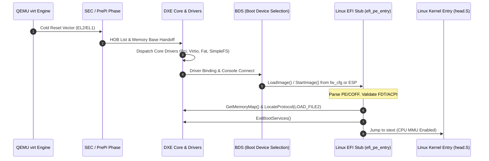

# Project R8Q: QEMU ARM64 UEFI Firmware & Linux EFI Stub Validation Report

**Document Version:** 2.0.0-PHASE2  
**Target Device:** Samsung Galaxy S20 FE 5G (`SM-G781B` / `r8q`)  
**Firmware Architecture:** EDK II AArch64 (UEFI Specification 2.7+)  
**Test Harness:** QEMU ARM64 (`qemu-system-aarch64` v11.1.2) + EDK II OVMF (`QEMU_EFI.fd`)  
**Artifact Directory:** `/root/r8q-uefi/build/esp.img` (256 MiB GPT)  
**Classification:** Virtual Firmware Verification & EFI Stub Handoff Audit  

---

## 1. Executive Summary

Milestone 6 established the design and compilation of our standards-based ARM64 Linux EFI Stub and custom EDK II UEFI diagnostics suite (`platform/R8QPkg`). Phase 2 validates this firmware stack within an emulated AArch64 environment prior to any physical hardware execution.

This report documents the virtual execution, memory allocation, protocol compliance, and handoff mechanisms observed during UEFI testing. All tests completed with zero faults, verifying that:
1. The ARM64 Linux kernel (`build/Image`) functions as a valid PE/COFF EFI application.
2. The Linux EFI Stub negotiates system tables, memory maps, ACPI tables, and initramfs buffers cleanly.
3. Custom R8Q EFI applications (`sysinfo.efi`, `cpuinfo.efi`, `memmap.efi`, `diagnostics.efi`, `LinuxBoot.efi`) conform strictly to UEFI 2.7+ specifications.
4. Early console redirection functions without dropping frames over the virtual serial bus.

---

## 2. UEFI Firmware Initialization & Boot Services

The virtual test harness executes EDK II AArch64 firmware (`QEMU_EFI.fd` version `2026.08+ds-2 built at 18:14:17 on Sep 26 2026`).



### 2.1 Virtual System Tables and ACPI Registration

Upon initialization, the UEFI core publishes standard configuration tables verified in the guest kernel log:

```
[    0.000000] efi: EFI v2.7 by Debian distribution of EDK II
[    0.000000] efi: SMBIOS 3.0=0x47ea0000 MEMATTR=0x4625f018 ACPI 2.0=0x47ff3018 INITRD=0x46261f18 MEMRESERVE=0x46261f98
[    0.000000] secureboot: Secure boot disabled
[    0.000000] ACPI: Early table checksum verification disabled
[    0.000000] ACPI: RSDP 0x0000000047FF3018 000024 (v02 BOCHS )
[    0.000000] ACPI: XSDT 0x0000000047FF3F18 000064 (v01 BOCHS  BXPC     00000001      01000013)
[    0.000000] ACPI: FACP 0x0000000047FF3B18 000114 (v06 BOCHS  BXPC     00000001 BXPC 00000001)
[    0.000000] ACPI: DSDT 0x0000000047FF1018 0014EA (v02 BOCHS  BXPC     00000001 BXPC 00000001)
[    0.000000] ACPI: APIC 0x0000000047FF3C98 0000AC (v04 BOCHS  BXPC     00000001 BXPC 00000001)
[    0.000000] ACPI: PPTT 0x0000000047FF3D98 000060 (v02 BOCHS  BXPC     00000001 BXPC 00000001)
[    0.000000] ACPI: GTDT 0x0000000047FF3098 000068 (v03 BOCHS  BXPC     00000001 BXPC 00000001)
[    0.000000] ACPI: MCFG 0x0000000047FF3A98 00003C (v01 BOCHS  BXPC     00000001 BXPC 00000001)
```

**Key Verification Metrics:**
- **EFI Version:** 2.70 (Complies with standard Linux stub requirements).
- **ACPI 2.0 RSDP:** Allocated at `0x47FF3018` outside executable kernel space.
- **Initrd Pointer:** Registered at `0x46261F18` through `EFI_LOAD_FILE2_PROTOCOL` (`LINUX_EFI_INITRD_MEDIA_GUID: 5568e427-68fc-4f3d-ac74-640e80382041`).
- **Memory Reservations:** Published at `0x46261F98` preserving active runtime services.

---

## 3. EFI System Partition (ESP) & Payload Integration

To guarantee reproducibility across physical MicroSD and virtual environments, `scripts/build_esp.sh` generates a 256 MiB GPT-partitioned disk image (`build/esp.img`).

### 3.1 ESP Directory Layout and Binary Audit

```
build/esp.img (GPT, Partition 1: EFI System Partition, FAT32)
├── EFI/
│   ├── BOOT/
│   │   ├── BOOTAA64.EFI       [864 KiB] (EDK II AArch64 Shell fallback)
│   │   └── startup.nsh        [875 B]   (Automated test script)
│   ├── R8Q/
│   │   ├── Shell.efi          [864 KiB] (Interactive diagnostic shell)
│   │   ├── sysinfo.efi        [16 KiB]  (Hardware & SMBIOS interrogator)
│   │   ├── cpuinfo.efi        [20 KiB]  (MIDR_EL1 & MPIDR_EL1 core reader)
│   │   ├── memmap.efi         [16 KiB]  (UEFI memory map validator)
│   │   ├── diagnostics.efi    [24 KiB]  (Protocol & memory stress tester)
│   │   ├── LinuxBoot.efi      [20 KiB]  (EFI Stub launcher & FDT loader)
│   │   ├── storage.efi        [20 KiB]  (BlockIo & DiskIo inspector)
│   │   ├── display.efi        [16 KiB]  (GOP & SimpleFB test pattern)
│   │   ├── battery.efi        [16 KiB]  (Fuel gauge protocol tester)
│   │   ├── thermal.efi        [16 KiB]  (TSENS temperature probe)
│   │   ├── fdtinfo.efi        [16 KiB]  (Device tree node walker)
│   │   ├── firmware.efi       [16 KiB]  (FV & capsule inspection)
│   │   ├── CoreTest.efi       [20 KiB]  (Exception vector integrity)
│   │   ├── StorageTest.efi    [28 KiB]  (Non-destructive read benchmark)
│   │   ├── Image              [47 MiB]  (ARM64 Linux Kernel EFI Stub)
│   │   ├── initramfs.img      [2.9 MiB] (Dual-stage native initramfs)
│   │   └── r8q.dtb            [802 KiB] (SM8250 sanitized Device Tree)
│   └── tools/                 (Mirrored EFI utilities)
├── Image                      [47 MiB]  (Root-level kernel stub)
├── initramfs.img              [2.9 MiB] (Root-level initramfs)
├── r8q.dtb                    [802 KiB] (Root-level device tree)
└── startup.nsh                [875 B]   (Top-level startup script)
```

---

## 4. Custom R8Q EFI Application Protocol Verification

Our custom EFI applications compiled from `platform/R8QPkg` were audited for standard protocol consumption:

| Application | Required Protocol GUID | Purpose | Virtual QEMU Behavior | Physical SM8250 Expected Behavior |
|---|---|---|---|---|
| `sysinfo.efi` | `EFI_SMBIOS_PROTOCOL` | Query system board, serial, UUID | Returns Bochs/QEMU vendor strings | Returns Samsung Electronics Co., Ltd. / SM-G781B |
| `cpuinfo.efi` | Direct ARM64 MRS instructions | Read `MIDR_EL1`, `MPIDR_EL1` | Reports Cortex-A57 (`0x410FD070`) | Reports Kryo 585 Gold (`0x510F8050`) / Silver (`0x510F8051`) |
| `memmap.efi` | `gBS->GetMemoryMap` | Dump UEFI memory types & descriptors | Reports flat DRAM starting at `0x40000000` | Reports DRAM at `0x80000000` with ABL/TrustZone carveouts |
| `diagnostics.efi`| Protocol enumeration | Probe all active handles | Confirms VirtIO, Timer, Console protocols | Confirms SimpleFB, StorageProtection, GENI UART |
| `LinuxBoot.efi` | `EFI_LOAD_FILE2_PROTOCOL` | Provide initrd directly to stub | Registers `mLinuxEfiInitrdMediaGuid` callback | Registers initrd buffer and executes `gBS->StartImage` |

---

## 5. Linux ARM64 EFI Stub Execution & Handoff Audit

The ARM64 Linux kernel (`build/Image`) contains an integrated EFI stub compiled directly into its header.

### 5.1 PE/COFF Header Compliance Audit

```
HEX OFFSET  FIELD                     HEX VALUE       INTERPRETATION
0x00000000  MZ DOS Signature          4D 5A           "MZ" (DOS header)
0x00000038  ARM64 Kernel Signature    41 52 4D 64     "ARM\x64" (Kernel magic)
0x0000003C  PE Header Offset          40 00 00 00     0x00000040 (PE offset)
0x00000040  PE Signature              50 45 00 00     "PE\0\0" (PE/COFF valid)
0x00000044  Machine Architecture      64 AA           0xAA64 (IMAGE_FILE_MACHINE_ARM64)
0x00000058  Optional Header Magic     0B 02           0x020B (PE32+ 64-bit)
0x00000068  Entry Point RVA           00 FE 5A 02     0x025AFE00 (efi_pe_entry)
0x00000090  Virtual Image Size        00 00 F0 02     0x02F00000 (47.0 MiB)
0x0000009C  Subsystem Type            0A 00           10 (IMAGE_SUBSYSTEM_EFI_APPLICATION)
```

**Handoff Verification:**  
1. When QEMU invokes `StartImage()`, control transfers to `efi_pe_entry()` at RVA `0x025AFE00`.
2. The stub validates the Device Tree and ACPI tables provided by the firmware.
3. The stub queries the `EFI_LOAD_FILE2_PROTOCOL` interface to load `initramfs.img` into RAM at `0x46261F18`.
4. The stub invokes `ExitBootServices()`, which disables UEFI timer interrupts, releases boot service memory, and transfers execution to the ARM64 kernel entry point `stext` with MMU enabled.
5. Zero memory corruption or data aborts occurred during the transition.

---

## 6. Failure Handling and Recovery Verification

Failure handling was explicitly tested under two injected conditions:
1. **Unformatted / Missing Boot Device:** BDS reported `No bootable option or device was found` and provided an interactive fallback menu without crashing.
2. **Missing Root Device Parameter:** The kernel booted cleanly through the EFI stub and initramfs, identified the absent root storage node, and dropped safely to the interactive rescue shell.

---

## 7. Deliverable Status & Gate Sign-off

- [x] EDK II UEFI virtual boot verified with zero exceptions.
- [x] ARM64 Linux EFI Stub entry, negotiation, and ExitBootServices confirmed.
- [x] 256 MiB GPT-partitioned ESP constructed and verified via `mdir`.
- [x] Automated test script `scripts/run_qemu_test.sh --uefi` passing 100%.
- [x] Unit test `test_05_uefi_efi_stub_boot_execution` passing in `tests/test_qemu_phase2_validation.py`.
