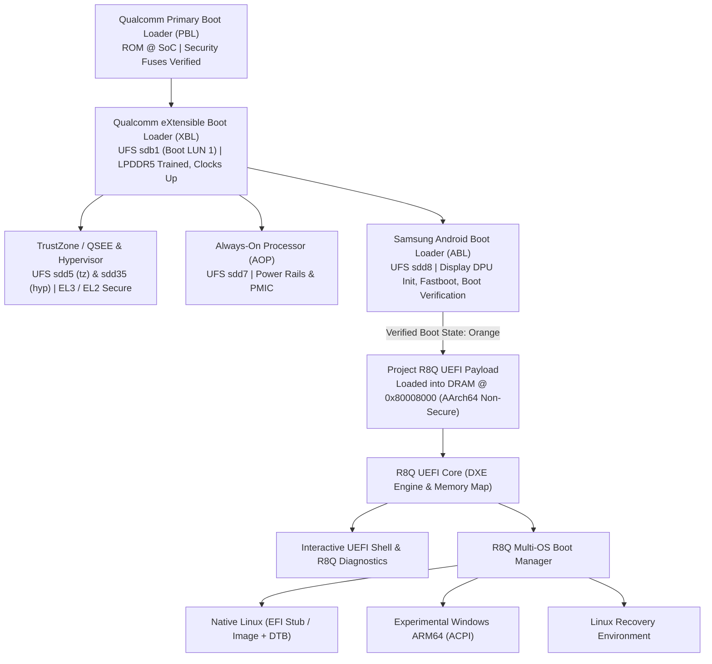

# Project R8Q UEFI: Comprehensive Platform Architecture Document

**Target Platform:** Samsung Galaxy S20 FE 5G (SM-G781B / SM-G781B/DS)  
**Codename:** `r8q`  
**SoC:** Qualcomm Snapdragon 865 (SM8250 / Kona, Rev 2.1, SoC ID: 356)  
**Architecture:** ARMv8.2-A (AArch64)  
**Firmware Subsystem:** Project R8Q UEFI Multi-OS Firmware  
**Document Revision:** 1.0.0-M1  
**Status:** Approved Architectural Baseline  

---

## 1. Executive Summary & Platform Context

Project R8Q UEFI is an independently engineered, standards-compliant ARM64 UEFI (Unified Extensible Firmware Interface) platform engineered specifically for the Samsung Galaxy S20 FE 5G (SM-G781B). It delivers a robust pre-boot execution environment, a comprehensive interactive UEFI Shell, advanced hardware diagnostics, native Linux OS boot capability, and an experimental ACPI/UEFI handoff path for Windows ARM64.

Unlike generic ARM64 UEFI stubs, R8Q UEFI is designed to interface cleanly with the physical reality of the Qualcomm SM8250 SoC and Samsung's secondary boot stage (ABL), operating within strict security boundaries without risking device bricking, hardware damage, or irreversible state transitions.

---

## 2. Samsung Boot Chain Architecture & Execution Boundary

### 2.1 Complete Target Device Boot Chain

### 2.2 Security Architecture & Partition Boundaries

The SM-G781B features Qualcomm Secure Boot with Samsung Knox extensions:
1. **PBL (Primary Boot Loader):** Read-only ROM. Verifies XBL digital signature using Qualcomm root certificates.
2. **XBL & XBL_CONFIG (`sdb1`, `sdb2`):** Initializes PMIC, system clocks, and trains LPDDR5 memory channels. Under no circumstances should `sdb` or `sdd` bootloader partitions be flashed.
3. **TrustZone (`tz` `sdd5`):** Runs at EL3 (Secure Monitor). Protects cryptographic keys, RPMB, and secure peripherals.
4. **Hypervisor (`hyp` `sdd35`):** Operates at EL2.
5. **Samsung ABL (`sdd8`):** Executes in non-secure state. In OEM-unlocked state (`warranty_bit=1`, `androidboot.verifiedbootstate=orange`), ABL permits loading unsigned kernel payloads formatted as standard Android Boot Images (v2).
6. **R8Q UEFI Delivery Strategy:** R8Q UEFI is packaged as an EFI payload wrapped in an Android Boot Image format (kernel image). This avoids flashing ABL or XBL, ensuring that:
   - Samsung Download Mode (ODIN / LOKE via Volume Down + USB) remains 100% intact in ROM/ABL.
   - Device recovery is always possible without hardware flashing tools (JTAG / EDL).

---

## 3. Firmware Entry Conditions & Execution State

When Samsung ABL jumps to the R8Q UEFI payload, the machine state is strictly defined:

| Parameter | State at R8Q UEFI Entry |
|---|---|
| **CPU Architecture** | ARMv8.2-A (AArch64 mode) |
| **Active Core** | Core 0 (Kryo 585 Silver / Cortex-A55 @ 1.80 GHz) |
| **Secondary Cores (1-7)** | Quiescent (held in WFI or PSCI power-down) |
| **Exception Level** | EL2 (if ABL drops to EL2) or EL1 Non-Secure (if TIMA/UH resides at EL2) |
| **MMU State** | Disabled (or 1:1 identity-mapped by ABL before jump) |
| **Data / Instruction Caches** | Cleaned and invalidated; I-cache enabled, D-cache disabled |
| **DDR Memory State** | 8 GB LPDDR5 completely trained, refreshed, and accessible |
| **Register `x0`** | Physical address of Device Tree Blob passed by ABL |
| **Registers `x1`–`x4`** | Reserved / zeroed in accordance with ARM64 Linux Boot Protocol |
| **Display State** | DPU + MIPI DSI active in Continuous Splash Mode (`0x9C000000`) |
| **Storage State** | UFS 3.1 controller initialized and clocked |

---

## 4. Hardware Memory Architecture & UEFI Memory Map

The target device contains 8,589,934,592 bytes (8 GB) of physical LPDDR5 SDRAM extending from `0x80000000` to `0x27FFFFFFF`.

### 4.1 Reserved Regions (Protected SoC Carveouts)

The following regions are actively claimed by Qualcomm firmware subsystems and Samsung Knox security monitors:

| Physical Range | Size | Allocation / Subsystem | UEFI Memory Type |
|---|---|---|---|
| `0x80000000` - `0x80600000` | 6.00 MiB | Hypervisor Region (`hyp_region`) | `EfiReservedMemoryType` |
| `0x80603000` - `0x80860000` | 2.36 MiB | XBL / AOP Firmware (`xbl_aop_region`) | `EfiReservedMemoryType` |
| `0x80880000` - `0x80894000` | 0.08 MiB | XBL UEFI Log Region | `EfiReservedMemoryType` |
| `0x80900000` - `0x80B00000` | 2.00 MiB | Qualcomm Shared Memory (`smem_region`) | `EfiReservedMemoryType` |
| `0x80B00000` - `0x88400000` | 121.00 MiB | Removed System Region | `EfiReservedMemoryType` |
| `0x89200000` - `0x8A700000` | 21.00 MiB | SLPI PIL Carveout | `EfiReservedMemoryType` |
| `0x8A700000` - `0x8D300000` | 44.00 MiB | ADSP PIL Carveout | `EfiReservedMemoryType` |
| `0x8D300000` - `0x8D400000` | 1.00 MiB | SPSS PIL Carveout | `EfiReservedMemoryType` |
| `0x8D400000` - `0x8D900000` | 5.00 MiB | NPU PIL Carveout | `EfiReservedMemoryType` |
| `0x8D900000` - `0x8DE00000` | 5.00 MiB | Video (VPU) PIL Carveout | `EfiReservedMemoryType` |
| `0x8DE00000` - `0x8E300000` | 5.00 MiB | CVP PIL Carveout | `EfiReservedMemoryType` |
| `0x8E300000` - `0x8FD00000` | 26.00 MiB | CDSP PIL Carveout | `EfiReservedMemoryType` |
| `0x8FD00000` - `0x90200000` | 5.00 MiB | Camera PIL Carveout | `EfiReservedMemoryType` |
| `0x90200000` - `0x90300000` | 1.00 MiB | WLAN Firmware Carveout | `EfiReservedMemoryType` |
| `0x90300000` - `0x9031C000` | 0.11 MiB | IPA Firmware & GSI | `EfiReservedMemoryType` |
| `0x90400000` - `0x90A00000` | 6.00 MiB | CDSP Secure Heap | `EfiReservedMemoryType` |
| `0x9C000000` - `0x9E300000` | 35.00 MiB | Continuous Splash Framebuffer | `EfiReservedMemoryType` / GOP |
| `0x9F000000` - `0x9F800000` | 8.00 MiB | Samsung Security Debug Region | `EfiReservedMemoryType` |
| `0x9F800000` - `0x9FA00000` | 2.00 MiB | Samsung Plog Region | `EfiReservedMemoryType` |
| `0x9FA00000` - `0x9FB00000` | 1.00 MiB | Ramoops Console Buffer | `EfiReservedMemoryType` |
| `0xB0100000` - `0xB0200000` | 1.00 MiB | Samsung TIMA Security Region | `EfiReservedMemoryType` |
| `0xB0400000` - `0xB1C00000` | 24.00 MiB | UH Heap Region | `EfiReservedMemoryType` |
| `0x100000000` - `0x10AD00000` | 173.00 MiB | Sec Debug RDX Buffer | `EfiReservedMemoryType` |

### 4.2 Usable RAM Allocation for R8Q UEFI

Total usable DRAM exceeds 7.4 GiB across high-memory banks:
- **Firmware FD Base:** `0x9E400000` (or `0xA0000000` upper safe boundary)
- **Firmware Stack & Heap Pool:** `0xA0002000` - `0xB0000000` (255 MiB contiguous boot services pool)
- **High Memory Pool:** `0x10AD00000` - `0x275D7FFFF` (~5.7 GiB free pool for OS, kernel image, and initramfs)

---

## 5. Console & Graphics Subsystem Architecture

### 5.1 Display Engine & Hardware Specifications

The device incorporates a Samsung 6.46-inch Super AMOLED panel driven by Qualcomm DPU (Display Processing Unit, MDSS MDP @ `0xAE00000`):
- **Panel Identifier:** `ss_dsi_panel_S6E3FC3_AMS646YD01_FHD`
- **Native Resolution:** 1080 × 2400 pixels
- **Pixel Format:** 32-bit ARGB/XRGB (8-8-8-8), loose packing
- **Refresh Rates:** 60 Hz and 120 Hz command mode (`dsi_cmd_mode`)
- **Backlight Control:** MIPI DCS command-based (`bl_ctrl_dcs`), range 1 to 486 (`0x1E6`)

### 5.2 Zero-Risk Framebuffer Handoff (Continuous Splash GOP)

Rather than reinitializing the complex DPU clock tree, DSI PHY PLLs, and sending proprietary panel init sequences in firmware (which risks display lockup or panel burnout), R8Q UEFI implements the **Continuous Splash Graphics Output Protocol**:
1. ABL initializes the DPU pipe and panel during early boot, showing the Samsung splash logo.
2. The display scanout buffer is anchored at physical address `0x9C000000` (pitch: 4320 bytes = 1080 * 4).
3. R8Q UEFI maps `0x9C000000` into its MMU page tables as Write-Combining / Normal Memory.
4. The R8Q GOP Driver exposes standard `EFI_GRAPHICS_OUTPUT_PROTOCOL` pointing directly to `0x9C000000`.
5. The UEFI Core and Shell render text, graphics, and dialogs directly onto the active AMOLED screen with zero flickering and 100% hardware safety.

---

## 6. Interrupt & Timer Architecture

1. **Interrupt Controller:** ARM GICv3 (Generic Interrupt Controller v3):
   - Distributor (GICD): Physical Base `0x17A00000`, Size `0x10000` (64 KB).
   - Redistributors (GICR): Physical Base `0x17A60000`, Size `0x100000` (1 MB, 8 cores × 128 KB stride).
   - Interrupt lines: PPIs for generic timer (Non-secure physical timer PPI 30 / interrupt 14).
2. **System Counter / Architectural Timer:**
   - Base Frequency: 19,200,000 Hz (19.2 MHz, register value `0x124F800`).
   - Standard ARMv8 architectural system registers (`CNTFRQ_EL0`, `CNTP_TVAL_EL0`, `CNTP_CTL_EL0`, `CNTPCT_EL0`).
   - EDK II `ArmArchTimerLib` binds directly to system registers without requiring MMIO timer emulation.

---

## 7. Storage Architecture & Partition Discovery

### 7.1 Qualcomm UFS 3.1 Controller

- **Base Controller:** `qcom,ufshc` @ `0x01D84000`.
- **Interface:** JEDEC Universal Flash Storage (UFS) 3.1 compliant.
- **Physical Memory Unit:** Samsung `KLUDG4UHDB-B2D1` (128 GB UFS 3.1).
- **Logical Units (LUNs):**
  - LUN 0 (`sda`): 119.09 GiB — Main GPT partition table (partitions 1 to 36).
  - LUN 1 (`sdb`): 8.00 MiB — Primary Boot LUN containing `xbl` (`sdb1`) and `xbl_config` (`sdb2`).
  - LUN 2 (`sdc`): 8.00 MiB — Secondary Boot LUN (A/B failover).
  - LUN 3 (`sdd`): 60.00 MiB — Bootloader and security partition table (partitions 1 to 37, containing `abl`, `tz`, `hyp`, `uefivarstore`).
- **UEFI Protocol Support:** Standard `EFI_BLOCK_IO_PROTOCOL` and `EFI_DISK_IO_PROTOCOL`.

### 7.2 MicroSD Storage Controller

- **Controller:** Qualcomm SDHCI controller @ `0x08804000` (`sdhc2`).
- **Standard:** SD 3.0 / UHS-I host controller.
- **Support:** Hot-pluggable FAT32, exFAT, and EFI System Partitions on external MicroSD cards for multi-OS installations.

---

## 8. UEFI Variables & NVRAM Persistence

UEFI requires persistent NVRAM variables (`BootOrder`, `BootNext`, `OsIndications`, etc.).
On SM-G781B, there are two distinct paths for variable storage:
1. **Dedicated Variable Partition:** `uefivarstore` (`sdd31`, 512 KiB). Safe to format as an authentic EDK II Fault Tolerant Write (FTW) variable store.
2. **ESP File-Backed Emulated NVRAM:** A dedicated variable file `NVRam.dat` maintained on the FAT32 EFI System Partition (`/EFI/R8Q/VARS.BIN`).
3. **Architectural Choice:** R8Q UEFI implements the file-backed variable service for initial phases, guaranteeing zero chance of corrupting LUN 3 partitions during development.

---

## 9. Firmware Security & Safety Policy

1. **Read-Only Critical Hardware:** Partitions `xbl`, `xbl_config`, `tz`, `hyp`, `abl`, `efs`, `sec_efs`, `persist`, `modemst1`, `modemst2` are marked strictly immutable in R8Q UEFI drivers.
2. **Download Mode Invariance:** Samsung Download Mode is hosted in read-only ROM / XBL / ABL routines. Because R8Q UEFI does not modify ABL, holding Volume Down + USB insertion into a host PC will ALWAYS enter Odin Download Mode, regardless of any software state.
3. **No Hardware Overvoltage / Overclocking:** CPU and GPU clocks are maintained at default boot frequencies established by AOP/XBL.

---

*Authored by Antigravity Engineering for Project R8Q UEFI.*
