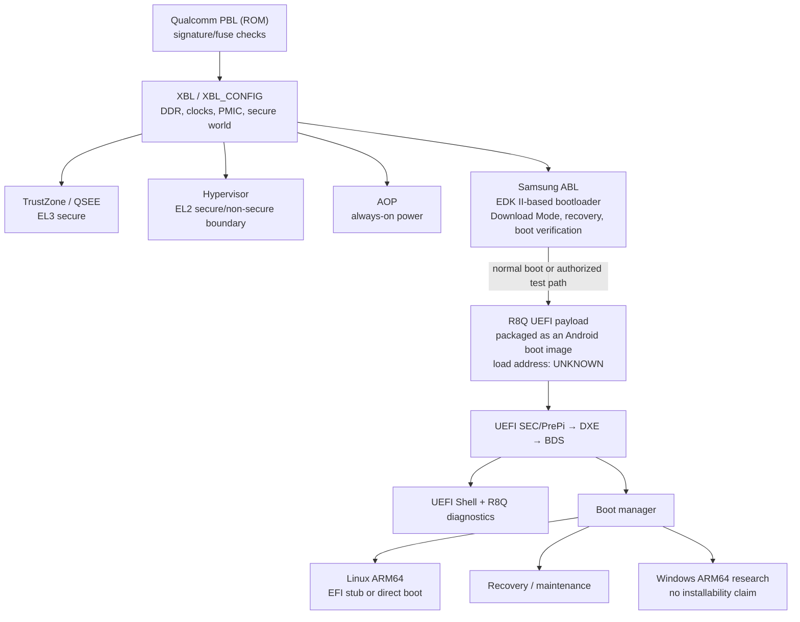

# Project R8Q UEFI: Platform Architecture

**Target:** Samsung Galaxy S20 FE 5G (`SM-G781B`, `r8q`, Qualcomm SM8250/Kona)
**Document revision:** 1.1.0-M1 (corrected baseline)
**Status:** Research architecture. Not a hardware-enablement claim.
**Supersedes:** `docs/UEFI_ARCHITECTURE.md` at commit `07b1882`.

---

## 1. Purpose

Project R8Q UEFI is an independent ARM64 UEFI platform intended to run after Samsung's stock boot chain and before an operating system. It is designed to provide a UEFI environment, a shell, diagnostics, a boot manager, Linux handoff, and an experimental Windows ARM64 research path.

The architecture is constrained by three rules:

1. **Do not replace PBL, XBL, or ABL.** The stock boot chain remains responsible for early DRAM, PMIC, secure world, and Download Mode.
2. **Do not assume hardware state.** Every address, carveout, panel, controller, and partition is either source-verified and re-checked at runtime, or treated as unknown.
3. **Do not make destructive changes during research.** Milestone 1 is documentation and host-side validation only.

---

## 2. Boot chain and execution boundary

The exact XBL/ABL partition locations, the payload load address, the exception level, and the handoff register state are **unknown** (`U`). They must be measured on the target unit. The diagram shows the functional chain, not a memory layout.

### 2.1 What is preserved

The following are boot-critical and are never written by R8Q UEFI during research or early bring-up:

- PBL (ROM), XBL, XBL_CONFIG, ABL;
- TrustZone/QSEE, hypervisor, AOP and other remote processors;
- `EFS`, `sec_efs`, `persist`, modem calibration, and other calibration/NVRAM partitions;
- stock recovery and Download Mode;
- the stock `BOOT` image and any partition needed to restore it.

The exact partition names and indices must be enumerated from the unit. The downstream FDT's `vbmeta` node lists names such as `boot`, `recovery`, `abl`, `xbl`, `tz`, and `hyp`; that is evidence of names, not of LUNs, indices, or sizes. See `docs/VERIFICATION_LEDGER.md`.

### 2.2 Integration hypothesis

Public community work suggests that a custom UEFI payload can be installed in Samsung's `BOOT` partition as an Android boot image, leaving ABL/XBL/recovery untouched. This is a **hypothesis for a later, explicitly authorized phase**:

- it has not been tested on this unit;
- `fastboot boot` is not a reliable retail-Samsung test path;
- a verified stock `BOOT` image, partition layout, and restore procedure must exist first;
- the user must authorize any write to the device.

No device modification is part of Milestone 1.

---

## 3. Execution state at handoff

The table records what the UEFI entry code must handle, not what ABL is assumed to provide.

| Item | Baseline status | Design response |
|---|---|---|
| CPU mode | AArch64 expected (`I`) | Check `CurrentEL`; do not assume EL1/EL2. |
| Active cores | Unknown (`U`) | Use only the boot CPU until PSCI is validated. |
| MMU/caches | Unknown (`U`) | Disable/reconfigure safely; invalidate caches/TLB as needed. |
| Interrupts | Unknown (`U`) | Mask DAIF and initialize GIC before enabling. |
| `x0` | DTB pointer likely (`I`) | Preserve it; validate the FDT header before use. |
| `x1`–`x3` | Unknown (`U`) | Do not rely on them. |
| Stack | Unknown (`U`) | Establish a known stack in a validated free region. |
| Display | Continuous splash may be active (`U`) | Probe the reserved framebuffer; do not reinitialize DPU/DSI. |
| Storage | UFS may be initialized (`U`) | Treat the controller as unknown; initialize from a clean state or reuse only if documented. |
| Memory map | Unknown (`U`) | Parse the live FDT `/memory` and `/reserved-memory`; never use a static 8 GB map. |

The `edk2-msm` PrePi reference handles both EL2 and EL1 and stores `x0` in a fixed device-tree slot. That is useful prior art, not proof of this unit's state. Its fixed slot (`0x80650000`) lies inside the downstream `xbl_aop` carveout and must not be reused without validation.

---

## 4. Memory architecture

### 4.1 RAM described by the captured downstream FDT

| Range | Size | Status |
|---|---:|---|
| `0x80000000`–`0xBBB00000` | `0x3BB00000` (~954.7 MiB) | `V-R8Q-FDT` for captured unit |
| `0xC0000000`–`0x280000000` | `0x1C0000000` (7,168 MiB) | `V-R8Q-FDT` for captured unit |
| `0xBBB00000`–`0xC0000000` | `0x4500000` (~69 MiB) | Not described as RAM; treat as reserved/unknown |

The total is approximately 7.93 GiB, consistent with an 8 GB class unit. This is not a license to hardcode 8 GB: 6 GB variants may exist, and the live map may differ.

### 4.2 Carveouts

The downstream `/reserved-memory` map is the primary target-specific evidence. Key regions:

- `hyp` at `0x80000000` + 6 MiB;
- `xbl_aop` at `0x80603000` + `0x25D000`;
- `cmd_db` at `0x80860000` + `0x20000`;
- XBL UEFI log at `0x80880000` + `0x14000`;
- `smem` at `0x80900000` + 2 MiB;
- `removed` at `0x80B00000` + 121 MiB;
- SLPI/ADSP/SPSS/NPU/video/CVP/CDSP/camera/WLAN/IPA/GPU PIL regions between `0x89200000` and `0x90400000`;
- continuous splash at `0x9C000000` + 35 MiB;
- display ramdump and DFPS data around the splash;
- Samsung security/debug/log/ramoops/TIMA regions at `0x9F000000`–`0xB0200000`;
- a large RDX buffer at `0x100000000` + 173 MiB;
- a vendor heap at `0xB0400000` + 24 MiB.

The full table, including dynamic pools and upstream differences, is in `docs/VERIFICATION_LEDGER.md`. The UEFI memory map must be built from the live FDT, not from a copied static table. Regions marked `no-map` or otherwise reserved by the vendor must be `EfiReservedMemoryType` (or `EfiMemoryMappedIO` for MMIO), never general-purpose RAM.

### 4.3 Candidate firmware window

The downstream map leaves a 12 MiB gap between the end of `dfps_data` (`0x9E400000`) and the start of `sec_debug` (`0x9F000000`). A 4 MiB firmware image plus early stack/heap could fit there, but this is an **inference**, not a validated load plan. The `edk2-msm` reference uses a different window (`0xCE000000` + 7 MiB), which is also only a candidate for this device.

The FD base must be a build-time parameter, not a universal constant. The runtime entry code must verify that its own image, stack, heap, and page tables do not overlap any live reserved region.

---

## 5. Console and display

### 5.1 Inherited framebuffer

The upstream Samsung common DTS and the downstream FDT both describe a continuous-splash framebuffer:

| Property | Value | Status |
|---|---|---|
| Base | `0x9C000000` | `V-L6.18`, `V-R8Q-FDT` |
| Size | `0x2300000` (35 MiB) | `V-L6.18`, `V-R8Q-FDT` |
| Width | 1080 | `V-L6.18`, `V-R8Q-FDT` |
| Height | 2400 | `V-L6.18`, `V-R8Q-FDT` |
| Stride | 4320 bytes | `V-L6.18` |
| Format | `a8r8g8b8` | `V-L6.18` |

The early GOP plan is to reuse this buffer **only if** the handoff probe confirms that scanout is active and the format/stride match. If the probe fails, the firmware must fall back to a serial console or a headless mode. It must not blindly reinitialize the DPU, DSI PHYs, PLLs, or panel.

### 5.2 Panel variants

The downstream FDT contains three panel definitions:

| Panel | Resolution | Timing entries | Backlight max |
|---|---|---|---|
| `S6E3FC3_AMS646YD01_FHD` | 1080×2400 | 60 Hz and 120 Hz | 486 (`0x1E6`) |
| `EA8076A_AMS646UJ10_FHD` | 1080×2400 | 60 Hz and 120 Hz | 425 (`0x1A9`) |
| `EA8079B_AMS646YB01_FHD` | 1080×2400 | 60 Hz and 120 Hz | 486 (`0x1E6`) |

The captured unit's bootargs select `S6E3FC3`. Other units may use the other panels. The firmware must not hardcode a panel model; it should use the inherited display state or a runtime panel ID. The refresh-rate entries above describe the downstream timing tables, not a guaranteed active mode.

### 5.3 MDSS/DSI addresses

- MDSS/DPU: `0xAE00000`;
- DSI PHY0/1: `0xAE94400`/`0xAE96400`;
- DSI PLL0/1: `0xAE94900`/`0xAE96900`;
- DP display: `0xAE90000`;
- RSCC: `0xAF20000`.

These are `V-R8Q-FDT`/`V-L6.18` addresses. They are documented for future driver work, not for unconditional reinitialization.

---

## 6. Interrupts and timer

| Block | Address | Status |
|---|---|---|
| GIC distributor | `0x17A00000`, 64 KiB | `V-L6.18` |
| GIC redistributors | `0x17A60000`, 1 MiB | `V-L6.18` |
| Generic timer frame | `0x17C20000` | `V-L6.18` |
| Timer frequency | 19,200,000 Hz | `V-L6.18` |

The architectural timer is accessed through `CNTFRQ_EL0`, `CNTPCT_EL0`, `CNTP_TVAL_EL0`, and `CNTP_CTL_EL0`. The GIC initialization must preserve secure interrupts and must not assume that the non-secure PPI/INTID assignment is already correct. The timer PPI mapping is an inference until validated on the unit.

---

## 7. Storage

### 7.1 UFS

- Host controller: `0x1D84000` + `0x3000`;
- UFS ICE: `0x1D90000` + `0x8000`;
- UFS PHY: `0x1D87000`;
- IRQ: SPI 265.

These are source-verified. The UFS device model, capacity, LUN count, LUN sizes, and partition indices are **unknown**. The firmware must enumerate them at runtime and must never hardcode `sda`/`sdb`/`sdc`/`sdd` or partition numbers.

The downstream `vbmeta` node lists partition names (`boot`, `recovery`, `abl`, `xbl`, `tz`, `hyp`, `dtbo`, etc.). Names are not indices; the mapping must be read from the partition table.

### 7.2 SDHCI

- Controller: `0x8804000` + `0x1000`;
- 4-bit bus;
- IRQs `0xCC` and `0xDE`.

MicroSD card detect, hotplug, UHS tuning, and filesystem support are not verified. The controller is a candidate for an external test ESP, but it must be brought up and validated before it is used as a variable store or boot medium.

### 7.3 UEFI variables

The early design uses a file-backed variable store on a disposable FAT32 ESP (for example, `EFI/R8Q/VARS.BIN`). It does not touch an internal `uefivarstore` partition, and it does not assume that such a partition exists or is safe to write. Runtime variable persistence after `ExitBootServices()` is an open design problem; file I/O drivers are not automatically runtime-safe.

---

## 8. USB, PCIe, and wireless

- USB: `ssusb@a600000`, DWC3 at `0xA600000`; downstream advertises DRD/super-speed, upstream mainline uses peripheral/high-speed. Host/XHCI support is **unknown** and is a major bring-up task.
- PCIe: controllers at `0x1C00000`, `0x1C08000`, `0x1C10000`; downstream WLAN is described as QCA6490 on root complex 0, while the Bluetooth node lists both QCA6390 and QCA6490. Endpoint/module enumeration and firmware loading are **unknown**.
- No UEFI Wi-Fi, Bluetooth, or USB-host functionality is claimed in Milestone 1.

---

## 9. Power, thermal, and input

- PMIC: PM8150/PM8150B/PM8150L family (plus PM8150A regulator nodes).
- Charger: MAX77705 at `0x66`, PCA9468 at `0x57`; SMB5 node is disabled. The active charging path is unknown.
- Fuel gauge: no MAX17042 node was found; the active gauge is unknown.
- Thermal: TSENS at `0xC222000`/`0xC263000` and `0xC223000`/`0xC265000`.
- Keys: volume-up is described as a GPIO key; power and volume-down handling are not confirmed.
- Touch: STM, Zinitix, Melfas, and A96T3X6 nodes exist; the installed controller is unknown.

Battery, thermal, and touch protocols are planned for later milestones. They are not implemented in Milestone 1.

---

## 10. Operating-system handoff

### 10.1 Linux

The primary path is the ARM64 Linux EFI stub: load the kernel `Image` as a PE/COFF image, pass the DTB and initrd through the UEFI configuration table or `/chosen`, call `ExitBootServices()`, and let the stub enter the kernel. A direct-boot fallback follows the ARM64 boot protocol (`x0` = DTB, `x1`–`x3` = 0). The exact kernel load address and the handling of the vendor carveouts are unverified. See `docs/LINUX_BOOT_DESIGN.md`.

### 10.2 Windows ARM64

Windows is a research target only. There are no ACPI tables, no UFS storage driver, no validated USB host stack, no display driver, and no boot evidence. No installability or functionality claim is made. See `docs/WINDOWS_COMPATIBILITY_REPORT.md`.

### 10.3 Recovery

The recovery plan is to preserve the stock recovery and Download Mode, keep a verified stock `BOOT` image offline, and require explicit authorization before any write. "Always recoverable" is not claimed; the restore path must be tested. See `docs/RECOVERY_AND_SAFETY_PLAN.md`.

---

## 11. Security boundaries

- PBL/XBL/ABL and the secure world are outside R8Q UEFI's ownership.
- R8Q UEFI runs non-secure and must not attempt to disable or reprogram TrustZone, RPMB, or secure clocks.
- The firmware must not write to boot-critical or calibration partitions.
- UEFI Secure Boot is not claimed. If it is added later, key management and the interaction with Samsung's verified boot must be designed explicitly.
- Bootloader unlocking, custom boot images, and any `BOOT` partition write affect Knox/warranty/DRM and require user authorization.

---

## 12. Open questions

1. What is the exact ABL handoff state (EL, MMU/caches, `x0`, secondary cores, display scanout)?
2. What is the exact payload load address and Android boot-image format accepted by this ABL?
3. What is the live UFS LUN/partition layout and storage capacity?
4. Which panel, touch controller, charger, fuel gauge, and WLAN variant is installed?
5. Does USB host mode work, and what role does the Type-C controller play?
6. Can the inherited framebuffer be used safely without reinitializing the display?
7. Which internal partitions are safe to read, and which must never be touched?
8. What is the tested restore path from a custom `BOOT` payload?

These questions are tracked in `docs/VERIFICATION_LEDGER.md` and must be closed before the corresponding hardware claims are made.
