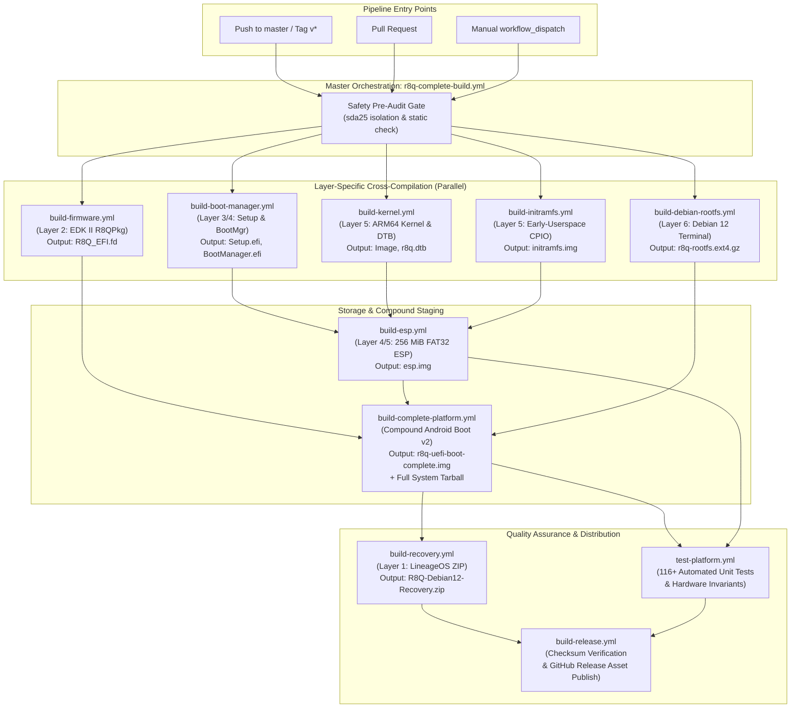

# Project R8Q — GitHub Actions CI/CD Architecture Specification

**Target Hardware:** Samsung Galaxy S20 FE 5G (`SM-G781B` / `r8q`)  
**Platform SoC:** Qualcomm Snapdragon 865 (`SM8250` / Kona)  
**Target Architecture:** ARM64 / AArch64 (ARMv8.2-A)  
**CI Host Runner:** GitHub Actions `ubuntu-latest` (x86_64 AMD64)  
**Document Revision:** 1.0.0 — Production Release  
**Status:** Authoritative CI/CD Architectural Specification  

---

## 1. Executive Summary & Design Principles

The Project R8Q GitHub Actions CI/CD system provides an **authoritative, standalone, fully reproducible build and validation environment**. Prior to this architecture, CI execution relied on pre-compiled binary payloads downloaded from static release tags. Under this specification, GitHub Actions standard runners (`ubuntu-latest` x86_64) independently cross-compile, assemble, validate, and package all six platform layers directly from source code without requiring local developer environments or physical hardware connections.

### Core Architectural Principles
1. **Absolute Hardware Safety (Zero Physical Block Access):** CI operates exclusively as a build, validation, and packaging engine. No physical flashing commands (`fastboot flash`, `heimdall`, `adb push`, raw block `dd`) are permitted.
2. **Strict Hardware Keystore (`sda25` / `keyrefuge`) Isolation:** Automated static safety gates verify that partition `/dev/block/sda25` is never referenced, read, formatted, or staged. All compound boot containers must strictly respect the +55.53 MiB safety headroom within recovery slot `sda24` (82,694,144 bytes maximum).
3. **Reproducible Cross-Compilation:** Cross-compiling AArch64 firmware, EFI applications, stub kernels, and root filesystems on x86_64 host runners with bit-exact determinism (`SOURCE_DATE_EPOCH=315532800`, normalized tar/cpio/zip ordering, static UID/GID 0).
4. **Decoupled Modular Workflows:** Each platform layer can be triggered independently on path-filtered changes (`push`, `pull_request`, `workflow_dispatch`), while a master orchestrator coordinates end-to-end releases.

---

## 2. CI/CD Architecture & Pipeline Topology

The CI/CD pipeline consists of 11 modular workflows: 1 Master Orchestrator, 8 Component Builders, 1 QA Test Suite, and 1 Distribution Publisher.

### Pipeline Dependency Graph

---

## 3. Workflow Specifications

### 3.1 Master Orchestrator (`.github/workflows/r8q-complete-build.yml`)
- **Triggers:** Push to `master`, release tags (`v*`), pull requests to `master`, or manual `workflow_dispatch`.
- **Inputs:**
  - `build_config`: `RELEASE` (default) or `DEBUG`.
  - `clean_build`: Boolean flag to force pristine rebuild.
  - `run_acceptance_tests`: Boolean flag (default `true`).
  - `release_version`: String tag (e.g. `v1.0.0-terminal`).
  - `publish_release`: Boolean flag to publish official assets.
- **Concurrency:** `r8q-complete-build-${{ github.ref }}` with `cancel-in-progress: false`.
- **Orchestration Mechanism:** Utilizes `workflow_call` declarations with strict `needs:` dependencies.

### 3.2 Layer 2: Firmware Volume (`.github/workflows/build-firmware.yml`)
- **Scope:** Compiles EDK II BaseTools on host x86_64, sets `GCC5_AARCH64_PREFIX=aarch64-linux-gnu-`, and builds `R8QPkg/R8QPkg.dsc` to produce `R8Q_EFI.fd`.
- **Memory Safety:** Initializes tmpfs `/dev/shm` to provide POSIX semaphores for Python build multiprocessing.
- **Artifacts:** `r8q-uefi-firmware-volume` (`build/R8Q_EFI.fd`, `R8Q_EFI.fd.sha256`).

### 3.3 Layer 3 & 4: BIOS Setup & Boot Manager (`.github/workflows/build-boot-manager.yml`)
- **Scope:** Standalone compilation of `platform/R8QPkg/Applications/Setup/Setup.inf` and `BootManager.inf`.
- **Validation:** Verifies PE32+ AArch64 machine headers (`0xAA64`), sub-system code `EFI_APPLICATION` (10), and generates `SHA256SUMS.txt`.
- **Artifacts:** `r8q-boot-manager-and-setup` (`output_bins/Setup.efi`, `output_bins/BootManager.efi`).

### 3.4 Layer 5: Kernel & Device Tree (`.github/workflows/build-kernel.yml`)
- **Scope:** Compiles DTS source into `sm8250-samsung-r8q.dtb` using `dtc`; invokes `scripts/build_kernel.sh` with `ARCH=arm64 CROSS_COMPILE=aarch64-linux-gnu-`.
- **Validation:** Confirms ARM64 PE/COFF EFI Stub magic at offset `0x38` (`b"ARM\x64"`).
- **Artifacts:** `r8q-kernel-and-dtb` (`Image`, `sm8250-samsung-r8q.dtb`, SHA256 manifests).

### 3.5 Layer 5: Early-Userspace Initramfs (`.github/workflows/build-initramfs.yml`)
- **Scope:** Invokes `scripts/build_initramfs.sh` using AArch64 BusyBox, builds root FHS tree, dynamic libraries, and mounts.
- **Validation:** Runs `tests/test_initramfs_validation.py` checking gzip magic `0x1f8b`, CPIO newc magic `070701`, and emergency rescue fallback.
- **Artifacts:** `r8q-initramfs` (`initramfs.img`, `initramfs.img.sha256`).

### 3.6 Layer 6: Debian 12 Terminal Rootfs (`.github/workflows/build-debian-rootfs.yml`)
- **Scope:** Packages pristine Debian 12 ARM64 ext4 root filesystem.
- **Validation:** Confirms ext4 superblock magic `0xEF53` at offset `1024 + 0x38`; runs `tests/test_rootfs_validation.py`; confirms `multi-user.target` default, `getty@tty1` enabled, and zero display managers.
- **Artifacts:** `r8q-debian12-rootfs-meta` (`rootfs.sha256`).

### 3.7 Layer 4 & 5: EFI System Partition (`.github/workflows/build-esp.yml`)
- **Scope:** Formats exact 256 MiB (268,435,456 bytes) FAT32 partition using `parted` and `mkfs.vfat`. Stages `BootManager.efi`, `Setup.efi`, `boot.cfg`, and OS entries.
- **Validation:** Uses `mdir -i esp.img@@1M ::EFI` to inspect internal FAT32 directory structure.
- **Artifacts:** `r8q-esp` (`esp.img`, `esp.img.sha256`).

### 3.8 Platform Integration (`.github/workflows/build-complete-platform.yml`)
- **Scope:** Combines `R8Q_EFI.fd`, `Image`, `initramfs.img`, and `sm8250-samsung-r8q.dtb` into Android Boot Image Header v2 container via `scripts/package_complete_boot_img.py`. Generates reproducible full system distribution tarball via `scripts/package_full_system.py`.
- **Safety Check:** Enforces exact partition bound: container must not exceed 82,694,144 bytes (`sda24` capacity) to prevent intrusion into `sda25`.
- **Artifacts:** `r8q-complete-boot-img`, `r8q-full-system-distribution`.

### 3.9 Recovery Installer ZIP (`.github/workflows/build-recovery.yml`)
- **Scope:** Packages flashable LineageOS recovery ZIP via `scripts/package_recovery_zip.py`.
- **Safety Check:** Asserts inclusion of `update-binary` with hardcoded boundary guards and sda25 protection assertions.
- **Artifacts:** `r8q-recovery-installer-zip` (`R8Q-Debian12-Recovery.zip`).

### 3.10 QA & Automated Test Suite (`.github/workflows/test-platform.yml`)
- **Scope:** Executes complete regression suite across 116+ automated unit tests.
- **Coverage:** Tests boot sequence, EDK II memory map, device tree bindings, rootfs invariants, recovery boundary safety, and terminal-first configuration.

### 3.11 Release Publisher (`.github/workflows/build-release.yml`)
- **Scope:** Verifies all 10 release artifacts against bit-for-bit `SHA256SUMS`.
- **Publishing:** Uses GitHub CLI (`gh release upload`) to publish official distribution bundles when triggered by tag `v*` or `publish_release=true`.

---

## 4. Cross-Compilation Matrix

| Platform Layer | Source Component | Host Runner (`x86_64`) Toolchain | Target Architecture |
|---|---|---|---|
| **Layer 2** | EDK II BaseTools | `gcc`, `g++`, `make`, `python3` (Native) | Host x86_64 ELF |
| **Layer 2** | EDK II R8Q Firmware | `aarch64-linux-gnu-gcc` (GCC5) | AArch64 PE32+ / FV |
| **Layer 3** | R8Q BIOS Setup | `aarch64-linux-gnu-gcc` (GCC5) | AArch64 PE32+ (`Setup.efi`) |
| **Layer 4** | R8Q Boot Manager | `aarch64-linux-gnu-gcc` (GCC5) | AArch64 PE32+ (`BootManager.efi`) |
| **Layer 5** | Device Tree | `device-tree-compiler` (`dtc`) | FDT / Flattened Device Tree |
| **Layer 5** | Linux Kernel | `aarch64-linux-gnu-gcc` (`ARCH=arm64`) | ARM64 Linux EFI Stub Image |
| **Layer 5** | Early Initramfs | `cpio`, `gzip`, BusyBox ARM64 | CPIO newc archive |
| **Layer 6** | Debian 12 Rootfs | `e2fsprogs`, `debootstrap`, `qemu-user` | ext4 ARM64 FHS 3.0 Filesystem |
| **Installer** | LineageOS ZIP | Python 3 `zipfile` | Android Recovery Container |

---

## 5. Artifact Retention & Handoff Strategy

Artifacts are passed between pipeline stages using GitHub Actions `actions/upload-artifact@v4` and `actions/download-artifact@v4`.

| Artifact Name | Generating Workflow | Consuming Workflows | Retention |
|---|---|---|---|
| `r8q-uefi-firmware-volume` | `build-firmware.yml` | `build-complete-platform.yml` | 30 Days |
| `r8q-boot-manager-and-setup`| `build-boot-manager.yml`| `build-esp.yml` | 30 Days |
| `r8q-kernel-and-dtb` | `build-kernel.yml` | `build-esp.yml`, `build-complete-platform.yml` | 30 Days |
| `r8q-initramfs` | `build-initramfs.yml` | `build-esp.yml`, `build-complete-platform.yml` | 30 Days |
| `r8q-esp` | `build-esp.yml` | `build-complete-platform.yml`, `test-platform.yml` | 30 Days |
| `r8q-debian12-rootfs-meta` | `build-debian-rootfs.yml`| `build-complete-platform.yml` | 30 Days |
| `r8q-complete-boot-img` | `build-complete-platform.yml` | `build-recovery.yml`, `test-platform.yml` | 30 Days |
| `r8q-recovery-installer-zip`| `build-recovery.yml` | `build-release.yml` | 30 Days |
| `r8q-full-system-distribution`| `build-complete-platform.yml` | `build-release.yml` | 90 Days |
